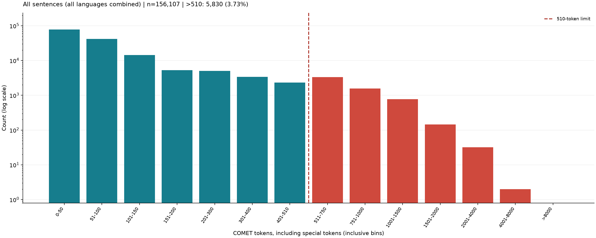
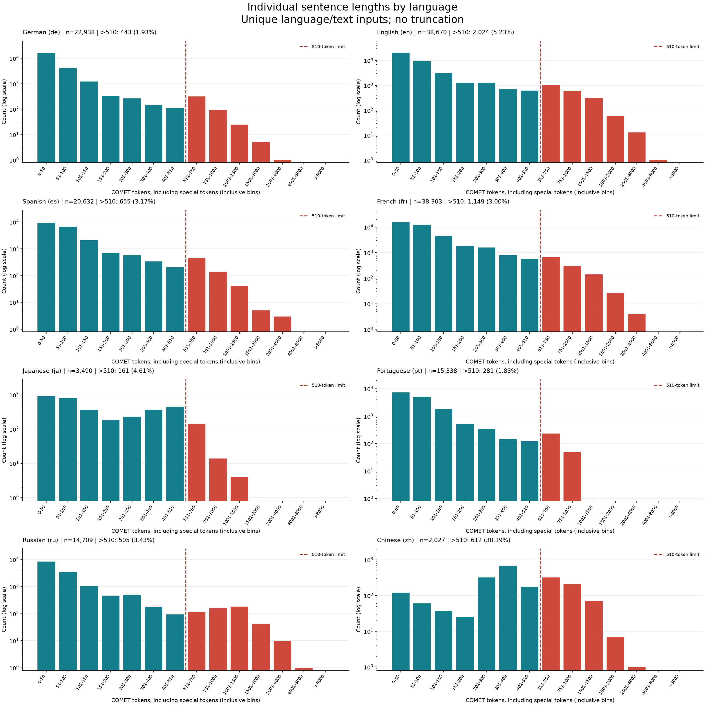
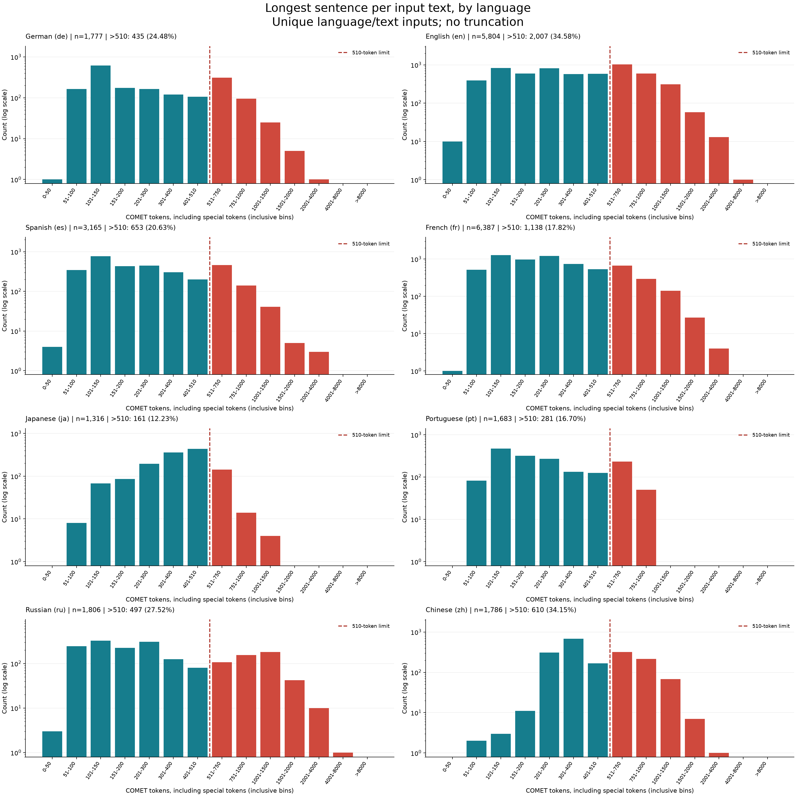
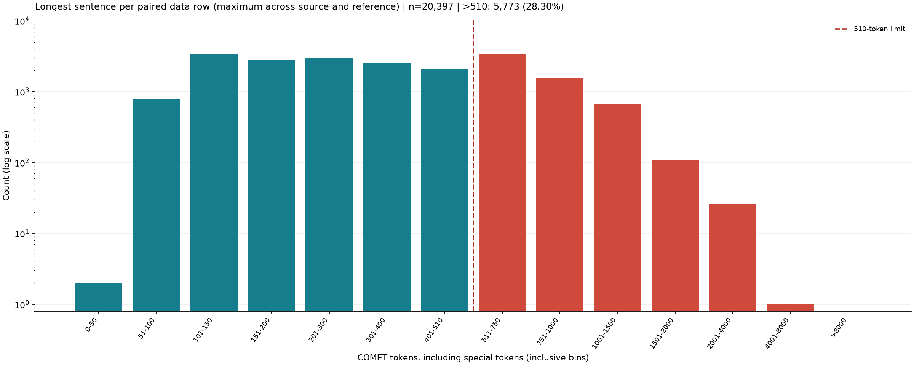

# Evaluation Metrics

This project computes automatic reference-based metrics for source-pair benchmark datasets using
`scripts/evaluate_parallel_manifest.py`. The bare CLI default computes the standard metric suite,
including learned model metrics and `fsp_mqm`. Use repeated `--metric` flags to override that set.
The default requires downloaded BERTScore, COMET, COMETKiwi, and XCOMET models, accepted model
terms where applicable, and an OpenAI-compatible API configuration for `fsp_mqm`; it incurs one
judge request per evaluated row.

`config/evaluation/default.toml` explicitly selects the same full suite. Use
`config/evaluation/cheap.toml` when model downloads and LLM judge calls are not appropriate.

The metric registry and dispatch live in
[metrics.py](../src/chem_machine_translation/evaluation/metrics.py).
The call below shows the document-evaluation arguments; other optional metric-specific
arguments are omitted:

```python
details = {}
metrics = compute_translation_metrics(
  prediction=prediction,
  reference=reference,
  source=source,
  metric_names=("comet", "reference_assignment_comet", "sentalign_comet"),
  metric_details=details,
  source_language="en",
  target_language="de",
)
```

Each benchmark row stores these values under the `metrics` field in the JSONL report. The evaluation
scripts also print target-language summaries. For BLEU, chrF, and chrF2++, the printed summaries use
SacreBLEU corpus scoring, which is closer to WMT reporting than averaging sentence scores. Other
metrics are averaged over evaluated rows.

## Metric Groups

We separate metrics into two groups:

- **General metrics**: language-agnostic reference-overlap metrics. These are useful for comparing
  systems on the same benchmark, but they do not understand chemistry.
- **Domain-specific metrics**: chemistry- or patent-aware checks. These are intended to measure
  things like formula preservation, terminology consistency, and chemical identity.

At the moment, the codebase implements `sequence_similarity`, BLEU, chrF, chrF2++,
reference-based BERTScore, BLEURT, whole-record COMET, Reference Assignment COMET, SentAlign-COMET,
Reference Assignment MetricX-24, SentAlign-MetricX-24,
reference-free COMETKiwi QE, XCOMET-XL, strict and
variant-aware target-side terminology coverage, term-only BERTScore recall, strict and variant-aware
source-conditioned terminology success rates, and optional `fsp_mqm` LLM judging. The benchmark
builders can generate terminology mappings in manifest rows. Terminology consistency is not wired into
`compute_translation_metrics` yet.

Terminology metrics can filter manifest terms by `term_group`. The supported groups are `llm`,
`algorithmic`, `verified`, and `refined`. The code-level default is `verified`; the standard
evaluation configurations select `refined` terms. A metric set can also require `verified_by`
evidence.

## Current Status

Implemented in code:

- `sequence_similarity`: simple string-level similarity, useful as a sanity check.
- `bleu`: SacreBLEU BLEU. Row reports use sentence BLEU; printed summaries use corpus BLEU.
- `chrf`: SacreBLEU chrF. Row reports use sentence chrF; printed summaries use corpus chrF.
- `chrf2++`: WMT-style chrF with word bigrams. Row reports use sentence chrF2++; printed summaries
  use corpus chrF2++.
- `bertscore`: contextual token-alignment F1 with `xlm-roberta-large`. It also records precision and
  recall; it is not whole-text embedding cosine similarity.
- `bleurt`: optional reference-based BLEURT score from a local BLEURT checkpoint. It is selectable,
  but excluded from defaults because its TensorFlow-based package is an optional Git dependency.
- `term_bertscore_recall`: multilingual BERTScore recall from selected curated reference target terms
  to the full prediction. It is a soft term-retention metric, not precision or F1.
- `comet`: reference-based COMET with `Unbabel/wmt22-comet-da`, useful for semantic MT quality.
- `reference_assignment_comet`: our custom reference-anchored, order-unrestricted one-to-one
  sentence matching followed by COMET and explicit gap penalties. Opt-in only.
- `sentalign_comet`: official SentAlign 2.0.0 monotonic many-to-many matching in our
  reference-anchored COMET protocol. Uses BGE-M3/CLS in this project. Opt-in only.
- `aligned_comet`: legacy alias of `reference_assignment_comet`, not a fourth method.
- `reference_assignment_metricx`: the same custom one-to-one reference assignment followed by
  MetricX-24 error scoring. Native 0-25 scale, lower is better. Opt-in only.
- `sentalign_metricx`: the same official SentAlign reference-span closure followed by MetricX-24
  error scoring. Native 0-25 scale, lower is better. Opt-in only.
- `cometkiwi_qe`: reference-free COMET quality estimation with `Unbabel/wmt22-cometkiwi-da`. It uses
  source and prediction only, so it is useful when a trusted reference is unavailable or reference overlap
  would be misleading.
- `xcomet_xl`: reference-based `Unbabel/XCOMET-XL` score plus target-side MQM-style error spans.
- `target_term_coverage`: manifest-based target terminology coverage. It is included in defaults,
  but only produces a row score when manifest terminology exists for that row.
- `variant_aware_target_term_coverage`: accepts the canonical target term or an explicit external
  candidate variant stored in the manifest. It is included beside strict coverage in standard configs.
- `terminology_success_rate`: source-conditioned WMT-style terminology accuracy. It is still
  available explicitly, but is not in defaults.
- `variant_aware_terminology_success_rate`: source-conditioned terminology accuracy that accepts
  explicit external candidate variants in addition to canonical target terms.
- `fsp_mqm`: LLM-as-judge MQM-style metric. It is included in the full default and makes one API call
  per evaluated row.

### Metric Selection Reference

| Metric | Registry name | Inputs | Standard configurations |
| --- | --- | --- | --- |
| Sequence similarity | `sequence_similarity` | prediction, reference | Yes |
| BLEU | `bleu` | prediction, reference | Yes |
| chrF | `chrf` | prediction, reference | No |
| chrF2++ | `chrf2++` | prediction, reference | Yes |
| BERTScore | `bertscore` | prediction, reference | Full default |
| BLEURT | `bleurt` | prediction, reference, local checkpoint | Optional |
| Term BERTScore recall | `term_bertscore_recall` | prediction, reference, manifest terminology | Full default |
| Reference-based COMET | `comet` | source, prediction, reference | Full default |
| Reference Assignment COMET | `reference_assignment_comet` | source, prediction, reference | Optional |
| SentAlign-COMET | `sentalign_comet` | source, prediction, reference; SentAlign extra | Optional |
| Legacy Reference Assignment COMET alias | `aligned_comet` | source, prediction, reference | Optional |
| COMETKiwi QE | `cometkiwi_qe` | source, prediction | Full default |
| XCOMET-XL | `xcomet_xl` | source, prediction, reference | Full default |
| Target term coverage | `target_term_coverage` | prediction, reference, manifest terminology | Yes |
| Variant-aware target coverage | `variant_aware_target_term_coverage` | prediction, reference, terminology variants | Yes |
| Terminology success rate | `terminology_success_rate` | source, prediction, reference, manifest terminology | Yes |
| Variant-aware terminology success | `variant_aware_terminology_success_rate` | source, prediction, reference, terminology variants | Yes |
| MQM-style LLM judge | `fsp_mqm` | source, prediction, reference, judge API | Full default |

The four terminology metrics return no row score when no applicable manifest terms remain after
filtering. Reports should retain their applicable-row count when comparing systems.

### BLEURT

BLEURT is optional. Install its TensorFlow-based official package and provide a downloaded local
checkpoint when selecting it:

```powershell
uv sync --extra bleurt
uv run --no-sync python scripts/evaluate_parallel_manifest.py `
  --dataset-dir <dataset-dir> --output <report.jsonl> `
  --metric bleurt --bleurt-checkpoint <local-bleurt-checkpoint>
```

Experiment configurations use `bleurt_checkpoint = "<local-bleurt-checkpoint>"` alongside
`metrics = ["bleurt"]`. BLEURT is intentionally excluded from the bare CLI and standard evaluation
defaults.

## Document Evaluation Overview

The evaluation model and the alignment algorithm solve different problems. **COMET judges the
quality of an already formed source/candidate/reference triple.** An aligner decides which pieces
of a long document belong in that triple. BGE-M3 supplies alignment embeddings only; it does not
replace COMET's own learned encoder or scoring model.

Use S for source sentences, R for reference sentences, and C for candidate sentences.
The four approaches discussed here are:

| Approach | What is aligned first? | Order and grouping | Evaluation unit | Project status |
| --- | --- | --- | --- | --- |
| Ordinary COMET | Nothing; pass each entire record | No explicit sentence alignment | One whole-record triple | Implemented as `comet` |
| Reference Assignment COMET | R-to-S and R-to-C independently | One-to-one; crossings allowed | One block per reference plus unmatched sentences | Custom protocol; implemented |
| SentAlign-COMET | R-to-S and R-to-C independently | Monotonic contiguous many-to-many | Common reference-span groups plus unmatched spans | Custom protocol with official aligner; implemented |
| SEGALE | S-to-C; use prepared S-to-R correspondence for reference metrics | Monotonic contiguous many-to-many with adaptive Vecalign selection | Source/candidate spans, with references attached through source indices | Published scheme; not implemented or benchmarked here |

**Monotonic** means an alignment cannot cross: an earlier source span cannot match a later
candidate span while a later source span matches an earlier candidate span. **Many-to-many** means
a contiguous group on one side can match a contiguous group on the other, such as one sentence
translated as two sentences. A **null link** has no text on one side and can represent an omission,
addition, or alignment failure. It is not proof that the translator made that error.

The three implemented methods share `Unbabel/wmt22-comet-da` in the comparison, but do not share
the same units or weighting. For either aligned variant, if there are B total blocks, M complete
triples with COMET scores q, and configured gap score g, the document score is:

$$
Q = \frac{\sum_{b \in M} q_b + (B - |M|)g}{B},
\qquad \text{null ratio} = 1 - \frac{|M|}{B}.
$$

Here g defaults to zero. A block with ten sentences still has the weight of one block. These
quantities are not percentages of translated content, and raw scores across differently grouped
methods should not be interpreted as interchangeable quality scales.

## Ordinary COMET

`comet` sends a row's complete `source`, `prediction`, and `reference` strings to the official
Unbabel scorer. The wrapper builds `src`, `mt`, and `ref` fields, calls the loaded model once for
the row, and returns its segment score. It performs no sentence segmentation, BGE embedding,
re-alignment, explicit omission/addition counting, or document-specific aggregation. A short
sentence or paragraph can therefore be evaluated without an alignment stage.

For the cached `Unbabel/wmt22-comet-da` checkpoint tested here, the normal encoder preparation
retains at most **510 tokens per input, including special tokens**. The limit is per source,
candidate, and reference, not a combined 510-token budget. Whole-record calls do not raise an
over-budget error in our wrapper; long strings are silently truncated by model preprocessing.
A score can consequently be high even when an unobserved ending is wrong or missing.

This is why a sentence-level metric cannot simply be applied to a book-length string and be
assumed to evaluate the entire book. The aligned variants send multiple smaller triples instead,
checking their scoring limits before inference. They improve coverage but introduce segmentation,
matching, gap handling, and weighting assumptions. Neither turns COMET into an explicit judge of
cross-sentence coherence, persistent terminology consistency, or logical contradiction.

Use ordinary COMET as a standard short-input baseline. Do not treat a whole-record score as a
complete long-document assessment without first auditing what the scorer retained.

## Reference Assignment COMET

`reference_assignment_comet` is the explicit name of our existing custom opt-in document metric.
`aligned_comet` remains a backwards-compatible alias; it does not select SentAlign.
The metric segments the source, reference, and prediction,
embeds the sentences with the public `BAAI/bge-m3` dense encoder, and pairs reference sentences
separately with source and prediction sentences using SciPy's linear assignment solver. Assignment
uses cosine distance and permits unmatched sentences below `minimum_similarity`. Matched triples
are scored with `Unbabel/wmt22-comet-da`; unmatched references, translations, and source sentences
receive the configured `null_score` (default 0). The document score is the equal-weight mean of all
blocks, including penalties. `reference_assignment_comet_null_alignment_ratio` reports the fraction of blocks
that could not form a complete triple, including source-reference alignment failures.

This is a reference-anchored, one-to-one assignment protocol, **not an exact SEGALE reproduction**.
It allows reordered sentence matches but does not implement SEGALE's contiguous many-to-many
Vecalign search, adaptive skip-penalty search, or fine-tuned BGE-M3 checkpoint. Sentence merges or
splits can therefore be misclassified as unmatched content. The default similarity threshold is a
configurable starting point, not a calibrated translation-quality threshold. Validate segmentation
and alignment on the target domain before comparing models. Local COMET scores are not a measure
of document-wide coherence or terminology consistency.

The default segmenter is spaCy's language-neutral rule-based sentencizer, applied within paragraphs;
it needs no language-model downloads. Language-specific pretrained spaCy pipelines can be selected
via `segmenter_models`, for example `{ de = "de_core_news_sm" }`, after installing those models.
BGE-M3 is documented as supporting more than 100 languages, including the benchmark languages
en/de/es/fr/pt/ru/zh/ja, but domain-specific alignment quality remains unverified.

The [reference-assignment preset](../config/evaluation/reference_assignment_comet.toml)
keeps the metric separate from existing defaults. The old aligned-comet preset still works.
All model IDs, CPU/GPU settings, batch sizes, sentence limits, token limits, pooling, and null
penalties are configurable under `[reference_assignment_comet]` (or legacy `[aligned_comet]`).
Model weights load lazily on the first scored
record. BGE-M3 and COMET downloads and inference require substantial memory and runtime.

```powershell
uv run --no-sync python scripts/evaluate_parallel_manifest.py `
  --dataset-dir <dataset-dir> --output <report.jsonl> `
  --metric reference_assignment_comet `
  --reference-assignment-comet-config config/evaluation/reference_assignment_comet.toml
```

That script generates translations using its configured translator; its default `dry-run` copies
the source and is only a pipeline check. Experiment TOMLs can reference the preset using
`[evaluation] config = "config/evaluation/reference_assignment_comet.toml"` or supply
`[evaluation.reference_assignment_comet]`
inline. Reference-only COMET checkpoints are required. Each matched input is checked with the
actual COMET tokenizer against both the configured token budget and the encoder's effective limit.
Over-budget embedding or scoring inputs raise errors instead of truncating; exceptionally long
individual sentences must be split explicitly. `max_sentences` caps assignment memory use.

`metric_details.reference_assignment_comet` preserves block texts, original sentence indices, match states,
scores, scoring token counts, languages, and effective protocol settings. These fields distinguish
penalties caused by alignment failures from model-produced COMET scores. Existing `comet` results
and defaults are unchanged.

### Exact Matching And Scoring Procedure

**Status:** this is our custom reference-anchored alignment-and-aggregation protocol. It is
implemented and has passed synthetic tests, but is not a finalized, independently validated
research metric or an exact implementation of a published document metric.

The controlling implementation is [aligned_comet.py](../src/chem_machine_translation/evaluation/aligned_comet.py).
For source sentences S, reference sentences R, and candidate sentences C:

1. Segment each document within nonempty newline-delimited paragraphs. By default, use spaCy's
  language-neutral sentencizer, not a pretrained language-specific segmentation model.
2. Encode unique sentence strings with public `BAAI/bge-m3`, using CLS pooling by default.
  L2-normalize vectors for cosine similarity during matching.
3. Independently solve R-to-S and R-to-C assignments. Each sentence can participate in at most one
  pair within each assignment. Matches may cross: original sentence order is not constrained.
4. For similarity s and threshold t (default 0.5), a real pair costs `1 - s` when `s > t`, and 4
  otherwise. Leaving one sentence unmatched costs `(1 - t) / 2`; dummy-to-dummy assignment costs
  zero. SciPy's `linear_sum_assignment` minimizes total cost on this augmented matrix. It is a
  global assignment, not independent nearest-neighbor selection or monotonic dynamic programming.
  Similarity exactly equal to the threshold is not an allowed match.
5. Create one block per reference sentence using its independently assigned source and candidate.
  Then append one block for each leftover candidate and each leftover source sentence.
6. Score complete triples with `Unbabel/wmt22-comet-da`. Check each source, reference, and candidate
  sentence against the smaller of the configured budget and actual COMET encoder limit. The tested
  checkpoint allows 510 tokens per input, including special tokens. Over-budget matched inputs
  raise an error; they are not silently truncated. Embedding inputs are also budget-checked.
7. Give incomplete blocks `null_score` (default 0) and take the equal-weight mean over all blocks.
  Neither sentence length nor document position affects aggregation weight.

| Block state | Meaning | Default score |
| --- | --- | --- |
| `matched` | Reference has both a source match and a candidate match | COMET score |
| `omission` | Reference has a source match but no candidate match | 0 |
| `source_unmatched` | Reference has no source match, even if a candidate matched | 0 |
| `addition` | Candidate sentence was not assigned to a reference | 0 |
| `source_only` | Source sentence was not assigned to a reference | 0 |

With zero penalties, the document score is the sum of complete-triple COMET scores divided by the
total number of blocks. The null ratio is `1 - matched_block_count / total_block_count`.
These are block-level quantities, not a calibrated percentage of correct translation or a direct
omission/hallucination rate. An unrelated replacement can create both an omission and an addition;
a failed source-reference match can create both a reference penalty and a leftover-source penalty.

For example, if one reference sentence becomes two candidate sentences, this matcher cannot give
both candidates to that reference. It may score one partial sentence and mark the other as an
addition. Conversely, two reference sentences merged into one candidate can leave one reference
unmatched. These are structural limitations, not necessarily mistranslations. If complete
independent statements exchange positions, crossing matches are allowed and can preserve the
control score; that also means this protocol does not penalize harmful reordering by itself.

### Synthetic Long-Prefix Benchmark

**Question tested:** does evaluating aligned sentences expose corrupted endings that whole-record
COMET largely misses because of its input limit?

The [benchmark runner](../scripts/test_aligned_comet_long_prefix.py) uses manually authored,
repeated synthetic sentences, not sampled patent/legal benchmark records or generated translations.
Each fixture keeps the same long correct prefix and has one of three candidate endings: correct
(`control`, candidate equals reference), unrelated content, or contradictory content. Corruptions
begin near the end of COMET's retained input window; they are not necessarily entirely outside it.

- 30 cases total: six original English-to-German cases at two prefix lengths, plus 24 multilingual
  cases covering eight directions and three conditions each.
- Directions: de-to-en, en-to-de, en-to-es, en-to-fr, en-to-pt, en-to-ru, en-to-zh, en-to-ja.
  This is not all-pairs coverage of those languages.
- Original shared prefixes contain 454 or 490 content tokens. Multilingual shared prefixes contain
  477-496 content tokens. References exceed 900 tokens; multilingual references exceed 1,000.
- Both methods use the same COMET checkpoint. Ordinary COMET receives whole records through its
  normal truncating encoder; our method receives token-checked complete sentence triples and zero
  penalties for incomplete blocks. This comparison therefore changes alignment and aggregation,
  not only truncation handling.
- The run uses CPU inference, four PyTorch threads, seed 42, batch size 8, BGE-M3 CLS pooling,
  similarity threshold 0.5, and zero null scores. Sentence embeddings and identical COMET triples
  are cached across cases. No LLM judge is used.

Results from the [2026-11-15 rerun](../reports/aligned_comet_long_prefix/bge_multilingual_results_rerun_20261115.json),
averaged equally across all cases in each condition (including the six original German cases):

| Candidate condition | Cases | Ordinary COMET mean | Reference Assignment COMET mean |
| --- | --- | --- | --- |
| Correct control | 10 | 0.9607 | 0.9695 |
| Unrelated ending | 10 | 0.9449 | 0.3360 |
| Contradictory ending | 10 | 0.9495 | 0.9047 |

All 30 cases completed with finite scores; all ten controls had zero incomplete blocks. Every
corrupted case scored below its corresponding control under our method. Inputs, configuration,
scores, null ratios, and drops from controls exactly reproduced the
[previous BGE-M3 run](../reports/aligned_comet_long_prefix/bge_multilingual_results.json).
All scored aligned inputs stayed within 510 tokens. Reports retain full texts, original indices,
block states and scores, token counts, first differing token positions, retained-token equality,
model/cache paths, and configuration. The earlier
[six-case MiniLM experiment](../reports/aligned_comet_long_prefix/results.json) is separate and does
not define the current embedding configuration.

**Interpretation:** the protocol strongly penalized these unrelated endings, while ordinary COMET
remained high. Contradictions still scored highly (aligned mean 0.9047), so this is not reliable
contradiction detection. The controls' different absolute scores do not establish better calibration.
Repeated fixtures, reference-identical controls, and a small designed case set cannot establish
human-judgment correlation, real-domain accuracy, statistical significance, or superior model rankings.

### Reproducing The Checks

Run from the repository root in the prepared environment. Real inference requires cached BGE-M3
and COMET weights and sufficient memory; the runner defaults to offline operation and does not
download missing models. Use a new output name because the runner writes the report incrementally
and will overwrite a file at the supplied path.

```powershell
uv run --no-sync python scripts/test_aligned_comet_long_prefix.py --list-cases
uv run --no-sync python scripts/test_aligned_comet_long_prefix.py --output reports/aligned_comet_long_prefix/new_run.json
uv run --no-sync pytest tests/test_aligned_comet.py tests/test_metrics.py tests/test_experiment_pipeline.py tests/test_evaluate_parallel_manifest.py -q
```

`--list-cases` checks only the 24 multilingual fixtures and requires a cached XLM-R tokenizer;
it does not run inference. The pytest command checks implementation and integration behavior with
test doubles; it is not the real-model benchmark. The earlier implementation validation recorded
68 passing tests. That test count is historical, not a fresh pytest run accompanying this document.

### Limitations And Related Work

One-to-one matching cannot represent sentence splits or merges. Unrestricted matching does not
penalize reordering. Independent reference-to-source and reference-to-candidate assignments do not
optimize triple quality jointly. Segmentation errors, threshold choice, cross-lingual embedding
errors, and source-reference mismatches can produce penalties unrelated to candidate quality.
Document-wide coherence and terminology consistency are not explicitly evaluated.

[SEGALE (2025)](https://aclanthology.org/2025.emnlp-main.1645/) is related work for alignment followed
by document evaluation, but its source-candidate monotonic, contiguous many-to-many alignment and
adaptive selection are fundamentally different from ours. It does not validate our matching rule.
[COMET (2020)](https://aclanthology.org/2020.emnlp-main.213/) and
[BGE-M3 (2024)](https://arxiv.org/abs/2402.03216) are component references, not validation of the
combined protocol. No exact published counterpart for our complete procedure has been verified;
this is not a claim of novelty. Real-domain alignment inspection, held-out threshold calibration,
human judgments, and real-domain comparisons remain outstanding. The SentAlign component comparison
below does not resolve those validation requirements.

## SentAlign-COMET

`sentalign_comet` is an opt-in variant of the same reference-anchored evaluation protocol, using the
official [SentAlign](https://github.com/steinst/SentAlign) Python package pinned to **2.0.0** instead
of our linear-assignment matcher. SentAlign provides contiguous, monotonic many-to-many sentence
alignment, including gaps. This is a custom composition of SentAlign and COMET, not a published
upstream metric or an exact reproduction of [SentAlign's 2023 paper](https://aclanthology.org/2023.emnlp-demo.22/).

At the user's request, both current aligners use public **BGE-M3 with CLS pooling**, CPU full
precision, batch size 8, and an 8,192-token embedding budget. SentAlign explicitly supports BGE-M3;
its original LaBSE/pooler/512-token configuration is not being used here. SentAlign's corrected
version-2 behavior is selected with `compat="none"`, one worker, the default `sentalign-dp` pathfinder,
up to four concatenated sentences per side, and cutoff 0.4. Our assignment matcher retains threshold
0.5. These cutoffs have different algorithmic roles; neither has been calibrated for this domain.
SentAlign's upstream documentation warns that encoder changes require cutoff tuning.

### Triple Construction And Safety

1. Use the same paragraph-aware segmenter and align reference-to-source and reference-to-candidate
  separately through official `SentAlign.align`. Retain null links, not only matched pairs.
2. Reject duplicate, missing, out-of-range, noncontiguous, or empty sentence-index links.
3. Where the two alignments group reference sentences differently, form the common coarsening:
  reference spans connected through either alignment become one block. Join each side's sentences
  in original index order. Every sentence contributes to exactly one block, including null blocks.
4. Append standalone candidate gaps as additions and standalone source gaps as source-only blocks.
  A reference group with no source is source-unmatched; one with a source but no candidate is an
  omission. If a larger group still contains some text on every side, COMET scores the complete
  grouped texts, even when a subset of reference indices had a null link on one side. The audit
  records those partial nulls explicitly; they do not receive a separate zero penalty.
5. Reuse the same reference-based COMET checkpoint, 510-token checks on **every complete grouped
  input before scoring**, zero scores for incomplete blocks, and equal-block averaging.

COMET inputs are never silently truncated. Connected reference groups can grow beyond four
sentences even though each pairwise link is capped at four; an oversized scoring group raises an
error rather than being silently split or truncated. Unlike our custom embedding wrapper, upstream
SentAlign may truncate embedding inputs at its configured budget. This limitation is recorded in
the audit and is distinct from COMET scoring safety.

`metric_details.sentalign_comet` includes grouped texts, plural sentence-index lists, partial-null
indices, COMET token counts/scores, raw pairwise links and similarity scores, anchors/timing info,
package version, full backend settings, and model/cache paths. The null ratio is the fraction of
incomplete **groups**, not sentences. Different group sizes change weighting and penalty counts;
the two aligned scores are not automatically calibrated to the same scale.

### How SentAlign Chooses Links

Official SentAlign computes embeddings for candidate sentence spans, including concatenations,
and uses its dynamic-programming pathfinder to select an ordered alignment. Span similarity,
concatenation/length penalties, and the configured cutoff influence whether the path matches a
span or skips text. This is not a linear assignment over individual sentence vectors, and the
cutoff is not a COMET quality threshold. We use the upstream algorithm rather than recreating
its path search in this repository.

For a split R1-to-(C1,C2), the adapter can concatenate C1 and C2 into one candidate input and
score it against R1 and its source. For a merge (R1,R2)-to-C1, it can concatenate the associated
source and reference sentences before scoring C1. No missing-content penalty is needed when
the full content is present in a different sentence structure.

The independent alignments can disagree about reference grouping. If R-to-S groups (R1,R2) and
R-to-C groups (R2,R3), our adapter must group (R1,R2,R3) together to avoid counting R2 twice.
This reference-span closure is **our adapter policy**, not an upstream SentAlign evaluation rule.
It can alter block weights, absorb a partial gap into a scored group, and enlarge scoring inputs.
Those effects are why the saved raw links and grouped triples are both needed for inspection.

### Three-Way BGE-M3 Comparison

The [comparison report](../reports/aligned_comet_long_prefix/three_metric_bge_comparison_20261115.json)
contains all texts and audits for **37 cases**: the preserved 30 multilingual long-prefix fixtures,
plus seven short English-to-German structural cases. All three methods completed all 37 cases;
the two prior methods reproduced the preserved 30-case scores exactly. Every SentAlign sentence
index was used once and all scored COMET inputs stayed within 510 tokens.

Long-prefix means, ten cases per condition:

| Condition | Ordinary COMET | Reference Assignment COMET | SentAlign-COMET |
| --- | --- | --- | --- |
| Correct control | 0.9607 | 0.9695 | 0.9695 |
| Unrelated ending | 0.9449 | 0.3360 | 0.4673 |
| Contradictory ending | 0.9495 | 0.9047 | 0.9047 |

Short structural diagnostics, one manually authored case per condition:

| Condition | Ordinary COMET | Reference Assignment COMET | SentAlign-COMET |
| --- | --- | --- | --- |
| Correct control | 0.9305 | 0.9621 | 0.9621 |
| Harmless sentence split | 0.9305 | 0.6663 | 0.9621 |
| Harmless sentence merge | 0.9175 | 0.5802 | 0.9445 |
| Omission | 0.8527 | 0.6448 | 0.6448 |
| Unrelated addition | 0.8360 | 0.7216 | 0.7216 |
| Duplicated sentence | 0.8433 | 0.7216 | 0.7216 |
| Reordered independent statements | 0.9113 | 0.9621 | 0.4836 |

**Recommendation from these synthetic cases:** prefer SentAlign-COMET for order-preserving
translations with differing sentence
boundaries. Its split and merge links were correct here, avoiding the custom matcher's false
penalties. Keep reference-assignment COMET when sentence reordering should be tolerated: SentAlign's
monotonic alignment turned the reordered case into one omission and one addition. Ordinary COMET
remains a useful short-input baseline, but is unsuitable as the sole evaluator of these long records.
Both aligned variants detect unrelated endings more strongly than ordinary COMET; both still score
contradictions highly. The different unrelated-ending scores cannot alone rank alignment quality,
because their group and penalty counts differ.

The real-record experiment below exposes additional failures on unchanged dataset references.
This synthetic recommendation is not a production-readiness claim.

This is a small synthetic diagnostic comparison, not human-correlated validation, significance
testing, or evidence of universally better translation-model rankings. Structural cases cover only
one direction. Domain segmentation checks, human alignment review, and held-out tuning are still
required before using either custom composite for research claims.

### Configuration And Reproduction

The [SentAlign preset](../config/evaluation/sentalign_comet.toml) uses `[sentalign_comet]`;
experiment configurations can supply `[evaluation.sentalign_comet]` inline. All new metrics remain
excluded from defaults. Install the optional component without replacing existing language wheels:

```powershell
uv pip install --python .venv/Scripts/python.exe "sentalign==2.0.0"
uv run --no-sync python scripts/evaluate_parallel_manifest.py `
  --dataset-dir <dataset-dir> --output <report.jsonl> `
  --metric comet --metric reference_assignment_comet --metric sentalign_comet `
  --reference-assignment-comet-config config/evaluation/reference_assignment_comet.toml `
  --sentalign-comet-config config/evaluation/sentalign_comet.toml
uv run --no-sync python scripts/test_aligned_comet_long_prefix.py --compare-three --list-cases
uv run --no-sync python scripts/test_aligned_comet_long_prefix.py --compare-three --output reports/aligned_comet_long_prefix/three_metric_bge_comparison_rerun.json
```

The real comparison runner requires cached BGE-M3 and COMET weights and sufficient memory.
Comparison mode refuses an existing output path to preserve reports. The list-only command checks
24 multilingual and seven structural fixtures without inference; the six original German fixtures
are added by the full run. The manifest evaluator generates translations rather than rescoring
historical outputs, and its default dry-run is only a wiring check.

## Real-Record Diagnostics

The earlier 37-case suite used authored text. The
[real-record runner](../scripts/evaluate_real_document_metrics.py) instead uses long records from
**all three current datasets**: Google Patents, JRC-Acquis articles, and JRC-Acquis definitions.
The [frozen fixture](../tests/fixtures/real_document_metrics.json) preserves the complete original
source/reference texts, nine donor records, document and row IDs, manifest line numbers, source
paths, token counts, and SHA-256 text hashes. The
[2026-11-17 report](../reports/real_document_metrics/comparison_20261117.json) contains all
constructed candidates, all scores and alignment audits, timings, model/package settings, and
expected-order checks, including failures.

A [Chinese patent fixture](../tests/fixtures/real_document_metrics_chinese_length_safe.json) and
[2026-11-18 rerun report](../reports/real_document_metrics/comparison_chinese_length_safe_20261118.json)
add one English-to-Chinese record and its real donor. The original nine-record fixture and report
are preserved unchanged. The Chinese record uses **the same eligibility rules and scorer settings
as the original nine** and is included in the four-record patent means below. An earlier Chinese
run that allowed oversized segments is retained only as a separate failure example, not as part
of this comparison.

### Selection And Candidate Construction

Three distinct primary documents per dataset were selected, one in each direction en-to-de,
en-to-fr, and en-to-es. Within each dataset/direction, choose the longest minimum source/reference
token length, breaking ties by record ID and excluding already selected document IDs. Selection
does not use metric scores. Eligibility requires 600-2,000 COMET tokens on **both** sides, at least
four segmented sentences on each side, and no individual sentence above 510 COMET tokens.
This last restriction excludes inherently over-budget sentences, not alignment failures or low
scores. Documents are neither repeated nor concatenated to make them long.

For the Chinese supplement, only Google Patents is selected, because the two JRC datasets do not
contain Chinese. The same 600-2,000-token range, four-segment minimum, and
510-token maximum per segment apply, with `--allow-overlong-sentences` **disabled**. Of 883
`en-zh` patent pairs, 579 meet the full-text length range and 13 also meet the segment-count
requirement; excluding the two with overlong segments leaves **11 eligible pairs**. The longest
eligible pair is selected without checking its scores: `TW-201519892-A`, whose largest segment
has 388 tokens. Its donor is a different eligible patent, `CN-101031558-B`, chosen by the same
nearest-reference-length rule. No Chinese-specific splitting or truncation setting is introduced.

The actual ten sources contain 757-1,437 tokens and their references contain 847-1,725 tokens.
Donors are distinct documents from the same dataset and language direction, chosen by nearest
reference token length. All 18 original primary/donor pairs were checked against their CSV text
and manifest IDs. The source-reference translations are dataset material, not newly authored
examples or new LLM outputs.

Each primary record produces eight candidates:

| Condition | Construction |
| --- | --- |
| `reference_control` | Exact, unmodified dataset reference |
| `tail_omission_25/50/75` | Remove the last approximately 25%, 50%, or 75% of reference sentences |
| `tail_replacement_25/50/75` | Replace that tail with sentences from its real donor record |
| `wrong_document` | Use the donor's full, unmodified reference |

The original run gives **9 primary records x 8 variants = 72 cases**, with **216 scoring attempts** across
ordinary COMET, Reference Assignment COMET, and SentAlign-COMET. Percentages describe sentence
counts, not token/meaning percentages or human quality ratings. Counts are rounded; exact affected
indices and actual fractions are saved. Donor sentences cycle if there are fewer donor sentences
than replacement positions. A donor from the same domain may share boilerplate or terminology;
"different document" does not guarantee every replacement sentence is semantically unrelated.

With the Chinese supplement, the combined inventory is **10 primary records, 80 cases, and 240
scoring attempts**, all yielding finite scores without scoring exceptions. The Chinese supplement
contributes eight cases and 24 successful scoring attempts under the original eligibility rules.

The reference control is a positive control relative to the dataset, not proof of a flawless
source-reference pair. Corrupted variants rejoin retained sentences with newlines; this can change
whitespace tokenization even before the intended corruption. Consequently, not every ordinary
COMET score change can be attributed solely to translation degradation. Exact retained-token
equality is recorded to identify the truncation-blind cases without making that assumption.
These are real-input, controlled-corruption diagnostics, not human-rated "good/half-bad" model
translations. The metric settings were not retuned after inspecting the outcomes.

### Selected Records

**All ten source texts are English.** The original targets are German (`de`), French (`fr`), and
Spanish (`es`), with one record per dataset/direction. Each original direction contributes three
primary records, 24 candidate cases, and 72 scores. Chinese (`zh`) adds one Google Patents record
and eight candidate cases; no Chinese JRC records or reverse directions are included. Google
Patents now has four primary records, while each JRC dataset retains three.

The case labels below are shorthand used only in this guide: `P` = Google Patents, `A` = JRC
articles, and `D` = JRC definitions. Patent records are abstract pairs; JRC records are anchored
chunks, not necessarily complete articles or definitions. In particular, definition-anchored
chunks can include surrounding recitals. Topics below describe the actual English source text,
not an assumed chemistry-only domain. JRC identifiers show document ID plus chunk ID; full
direction-qualified record IDs and original paths are in the frozen fixture.

Token counts use the COMET tokenizer, including special tokens. Sentence counts use the actual
default segmenter from this experiment; they are not manually corrected linguistic counts.
Both pairs of size columns are **source / reference**.

| Case | Direction | Document / chunk | Source topic | Tokens | Sentences |
| --- | --- | --- | --- | --- | --- |
| P-DE | en -> de | `WO-2021259536-A3` | Power-semiconductor contacts and sintering layers | 1071 / 1052 | 12 / 12 |
| P-FR | en -> fr | `EP-3080535-A2` | Lightweight ceramic aggregate made from coal ash | 1437 / 1725 | 9 / 10 |
| P-ES | en -> es | `WO-2012163308-A2` | Oil-industry wastewater treatment and solids/oil separation | 1250 / 1390 | 24 / 17 |
| P-ZH | en -> zh | `TW-201519892-A` | Crystalline laquinimod sodium particles, impurity limits and pharmaceutical quality control | 989 / 871 | 7 / 5 |
| A-DE | en -> de | `jrc22004D0121:chunk-0827` | EEA veterinary and phytosanitary rules | 930 / 992 | 11 / 26 |
| A-FR | en -> fr | `jrc22005A0315_01:chunk-1120` | TDCA amendments, agreement languages and originals | 924 / 1012 | 18 / 15 |
| A-ES | en -> es | `jrc22006D0045:chunk-1911` | EEA technical regulations, standards and certification | 833 / 973 | 15 / 11 |
| D-DE | en -> de | `jrc31995R0785:chunk-8798` | Dried-fodder market rules, checks and definitions | 903 / 923 | 5 / 27 |
| D-FR | en -> fr | `jrc21998A0403_01:chunk-0462` | Convention definitions, including maritime areas | 766 / 979 | 14 / 8 |
| D-ES | en -> es | `jrc31993R0404:chunk-8007` | Banana-sector market rules and supervision | 757 / 847 | 8 / 8 |

Lengths and boundaries differ materially between languages even within one paired record.
For example, P-FR has 1,437 source tokens versus 1,725 reference tokens, while D-DE has similar
token lengths but 5 versus 27 segments. Those are different challenges: document-window coverage
in the former case, and alignment granularity in the latter. The nominal 50% corruption is also
rounded by sentence count: it affects 8/17 sentences (47.1%) for P-ES and 14/27 (51.9%) for D-DE.

### Real-Record Results

All 80 cases completed with finite scores for all three methods and no scoring exceptions.
Both aligned scorers accounted for every segmented sentence exactly once. Every scored aligned
input stayed within the COMET limit; the largest had **481 tokens**. The Chinese record's largest
scored input was 388 tokens for Reference Assignment COMET and 428 tokens for SentAlign.

Google Patents means below now average **four records** per condition (`en-de`, `en-fr`, `en-es`,
`en-zh`); each JRC mean still averages three. These are equal-record means, not language-balanced
cross-dataset comparisons. Values are method-specific scales, not directly interchangeable quality
estimates:

| Dataset | Condition | Ordinary COMET | Reference Assignment COMET | SentAlign-COMET |
| --- | --- | --- | --- | --- |
| Google Patents | Reference control | 0.9134 | 0.7367 | 0.5863 |
| Google Patents | 50% tail omission | 0.9134 | 0.4068 | 0.3349 |
| Google Patents | 50% tail replacement | 0.9134 | 0.4220 | 0.3598 |
| Google Patents | Wrong document | 0.6275 | 0.1807 | 0.2031 |
| JRC articles | Reference control | 0.9211 | 0.6198 | 0.8407 |
| JRC articles | 50% tail omission | 0.9135 | 0.2816 | 0.3734 |
| JRC articles | 50% tail replacement | 0.9134 | 0.3895 | 0.5023 |
| JRC articles | Wrong document | 0.7332 | 0.2596 | 0.3764 |
| JRC definitions | Reference control | 0.9222 | 0.5424 | 0.3068 |
| JRC definitions | 50% tail omission | 0.9048 | 0.2540 | 0.1145 |
| JRC definitions | 50% tail replacement | 0.9049 | 0.3211 | 0.1567 |
| JRC definitions | Wrong document | 0.6677 | 0.0853 | 0.0657 |

#### Per-Record Scores

Each cell below is **ordinary COMET / Reference Assignment COMET / SentAlign-COMET**, rounded
to four decimals. "Control" is the exact reference; "wrong document" is the exact donor reference.
These are individual scores, unlike the dataset means above. Other severity levels and
unrounded values remain available in the linked JSON report.

| Case | Control | 50% tail omission | 50% tail replacement | Wrong document |
| --- | --- | --- | --- | --- |
| P-DE | 0.9252 / 0.9173 / 0.6570 | 0.9252 / 0.4569 / 0.3265 | 0.9252 / 0.6546 / 0.4199 | 0.7873 / 0.5570 / 0.3278 |
| P-FR | 0.8778 / 0.7897 / 0.3534 | 0.8778 / 0.4464 / 0.2562 | 0.8778 / 0.4341 / 0.3156 | 0.6015 / 0.0440 / 0.0759 |
| P-ES | 0.8952 / 0.5687 / 0.6667 | 0.8952 / 0.3208 / 0.3572 | 0.8952 / 0.2858 / 0.3929 | 0.4882 / 0.0769 / 0.0756 |
| P-ZH | 0.9553 / 0.6712 / 0.6679 | 0.9553 / 0.4030 / 0.3997 | 0.9553 / 0.3135 / 0.3109 | 0.6330 / 0.0447 / 0.3331 |
| A-DE | 0.9357 / 0.3848 / 0.9275 | 0.9281 / 0.1713 / 0.4183 | 0.9281 / 0.2881 / 0.4634 | 0.8580 / 0.2528 / 0.4016 |
| A-FR | 0.8999 / 0.7987 / 0.6730 | 0.8999 / 0.3685 / 0.2858 | 0.8999 / 0.3431 / 0.4094 | 0.5139 / 0.0991 / 0.1786 |
| A-ES | 0.9277 / 0.6759 / 0.9216 | 0.9127 / 0.3051 / 0.4161 | 0.9123 / 0.5374 / 0.6341 | 0.8278 / 0.4268 / 0.5489 |
| D-DE | 0.9290 / 0.1672 / 0.1016 | 0.8769 / 0.0350 / 0.0000 | 0.8772 / 0.1022 / 0.0489 | 0.7958 / 0.0500 / 0.0646 |
| D-FR | 0.9126 / 0.5217 / 0.3448 | 0.9126 / 0.2626 / 0.1854 | 0.9126 / 0.2468 / 0.1912 | 0.5502 / 0.0248 / 0.0417 |
| D-ES | 0.9249 / 0.9382 / 0.4741 | 0.9249 / 0.4645 / 0.1582 | 0.9249 / 0.6142 / 0.2300 | 0.6572 / 0.1812 / 0.0909 |

Several individual cases explain why the aggregate results need care:

- **P-DE: tail blindness despite clean one-to-one control alignment.** Removing half the
  reference sentences leaves ordinary COMET at 0.9252, while reference assignment drops from
  0.9173 to 0.4569. Its control has no null blocks, so this is not merely an already failing
  source-reference assignment. SentAlign's control nevertheless has a 28.6% null-block ratio.
- **A-DE: many-to-many alignment helps.** With 11 source versus 26 reference segments, reference
  assignment gives the unchanged reference 0.3848 and a 57.7% null-block ratio. SentAlign gives
  0.9275 with no null blocks. The difference demonstrates a real boundary mismatch, not a worse
  candidate translation under the first method.
- **D-ES: equal segment counts do not guarantee usable alignment.** Both sides have eight
  segments. Reference assignment gives the control 0.9382 with no null blocks, but SentAlign gives
  0.4741 with a 50.0% null-block ratio. Two segments on each side exceed its upstream 110-word
  limit. A sentence-count check alone would miss this constraint.
- **A-ES: wrong-document scores need not approach zero.** The donor scores 0.8278 under ordinary
  COMET, 0.4268 under reference assignment, and 0.5489 under SentAlign. These are same-domain legal
  texts, so shared language and boilerplate remain possible. A different document is a negative
  control by construction, not a human-certified zero-quality translation.

Null-block ratios above are the share of constructed scoring blocks assigned gap states, not
percentages of omitted words or meaning. Different aligners construct different blocks, so their
ratios are not directly interchangeable coverage estimates. With only one record per
dataset/direction, the table is diagnostic evidence, not a reliable ranking of these languages.

#### Chinese Results Under The Same Rules

P-ZH uses `TW-201519892-A`; its donor is the distinct `CN-101031558-B` patent (832 source / 787
reference tokens, maximum segment 296 tokens). The primary's seven source segments have lengths
388, 220, 43, 30, 194, 59, and 67 tokens. Its five reference segments have lengths **344, 265,
155, 54, and 61 tokens**. All primary and donor segments satisfy the same 510-token limit as the
other languages, without manual cleanup or Chinese-specific segmentation.

The Chinese control scores **0.9553 / 0.6712 / 0.6679** under ordinary COMET / Reference Assignment
COMET / SentAlign-COMET. Both aligners have five matched control blocks out of seven, with a
**28.6% null-block ratio**. The matched blocks contain substantive reference text, not the comment
fragments from the earlier oversized-input example. All 24 Chinese scoring attempts succeed.

The 25% and 50% omission and replacement variants retain the same ordinary-COMET candidate token
IDs as the control, so all four receive its exact score. The 75% omission and replacement scores
fall to 0.8841 and 0.8432, respectively. Fractions are still rounded by segment count: the 50%
variant changes 2/5 segments (40%), while 75% changes 4/5 (80%).

Reference Assignment COMET has strict severity ordering for both omission and replacement.
SentAlign has strict omission ordering, but its replacement score rises from **0.3109 at 50%**
to **0.4039 at 75%**. The donor's wrong-document scores are **0.6330 / 0.0447 / 0.3331**. Thus
consistent eligibility removes the earlier input-size rejection, not all alignment or calibration
limitations. This remains one Chinese record, not a Chinese-language quality benchmark.

The [earlier oversized-input fixture](../tests/fixtures/real_document_metrics_chinese.json) and
[its report](../reports/real_document_metrics/comparison_chinese_20261118.json) are preserved
separately. That `CN-105142674-A` example allowed overlong segments, rejected all eight Reference
Assignment COMET attempts, and scored only comment fragments in SentAlign's control. It is
**excluded from every comparison table, average, and expected-order total above and below**.
Its `Rejected` values indicate an input-size error, not a judgment of poor translation quality.

#### Expected-Order Checks

Expected-order checks are empirical diagnostics, not assertions that are forced to pass:

| Check | Ordinary COMET | Reference Assignment COMET | SentAlign-COMET |
| --- | --- | --- | --- |
| Reference control strictly above degraded variant | 36/70 | 70/70 | 70/70 |
| Strict ordering: control > 25% > 50% > 75% omission | 2/10 | 9/10 | 9/10 |
| Strict ordering: control > 25% > 50% > 75% replacement | 2/10 | 10/10 | 7/10 |

These checks combine the original nine records with the consistently selected Chinese case.
All comparisons are scored. The original control-above-degraded counts were 33/63, 63/63, and
63/63; Chinese adds 3/7, 7/7, and 7/7 respectively. The oversized-input example is not included.

Ordinary COMET tied its control exactly on **34 of 70 degraded cases** (30/63 originally, plus four
Chinese tail-corruption cases). In each of those 34 cases,
the retained candidate token IDs also equal those of the reference. For example, the English-to-
French patent record keeps ordinary COMET at 0.8778 even with 75% of reference sentences removed
or replaced. This is measured input-window blindness, not evidence that the corrupted ending is good.

### Alignment Failures On Controls

The real records reveal limitations concealed by the earlier authored examples. On the unchanged
German JRC definition reference, ordinary COMET scores 0.9290, reference assignment 0.1672, and
SentAlign-COMET 0.1016. The default segmenter produces **5 English source sentences versus 27 German
reference sentences**. Long English semicolon-separated recitals and fragmented German legal
abbreviations make one-to-one matching unsuitable and challenge SentAlign's four-sentence span cap.
Two English sentences also exceed SentAlign's default **110-word maximum per side**, so the
upstream pathfinder cannot match those spans even though their COMET token counts fit.

Other selected references have spans over that upstream word limit too. A perfectly identical
reference/candidate pair can consequently still produce null candidate links: matching is subject
to span constraints, not just cosine similarity. Source-reference or candidate-reference nulls are
alignment diagnostics and must not automatically be labelled translation omissions.

Severity ordering also has failures. Both aligned methods tie the 50% and 75% omission variants
of the German JRC definition case after usable matches are exhausted. SentAlign gives the 75%
replacement more credit than the 50% replacement in two JRC article cases. Changing alignments,
group weights, and partial-gap absorption can make a more extensively corrupted candidate score
higher; the report retains the raw links needed to investigate these cases.

**Conclusion:** on the consistently selected ten-record cohort, both aligned methods detect these constructed
long-tail corruptions more reliably than whole-record COMET, but neither is validated as a
calibrated document-quality score. The Chinese rerun succeeds without token-budget rejections
but retains an alignment-related severity-order failure for SentAlign replacement. The
reference-assignment variant has more consistent replacement ordering on this tiny selection;
SentAlign can handle real boundary changes but also has damaging span/length constraints with
current settings. Language-aware legal segmentation, word-limit/span inspection, and held-out
alignment validation are necessary before drawing production model rankings. This run does not
measure subtle mistranslation, negation accuracy, human correlation, or real model-output quality.

### Reproducing The Real-Record Checks

The regression tests use the frozen real texts and do not require the full dataset directories or
model downloads. Real scoring needs cached BGE-M3 and COMET weights and the SentAlign extra.
Use a new report filename; existing outputs are preserved.

```powershell
uv run --no-sync pytest tests/test_real_document_metrics.py -q
uv run --no-sync python scripts/evaluate_real_document_metrics.py `
  --fixtures tests/fixtures/real_document_metrics.json `
  --output reports/real_document_metrics/comparison_rerun.json
uv run --no-sync python scripts/evaluate_real_document_metrics.py `
  --fixtures tests/fixtures/real_document_metrics_chinese_length_safe.json `
  --output reports/real_document_metrics/comparison_chinese_rerun.json
```

To repeat selection from the full local dataset directories instead of using the frozen fixture:

```powershell
uv run --no-sync python scripts/evaluate_real_document_metrics.py --select-only `
  --output reports/real_document_metrics/fixtures_new.json
uv run --no-sync python scripts/evaluate_real_document_metrics.py --select-only `
  --only-dataset google_patents --directions en-zh `
  --output reports/real_document_metrics/fixtures_chinese_new.json
```

The selected directories and eligibility settings are recorded in the fixture. The three dataset
keys remain separate even though both JRC datasets identify their upstream corpus as `jrc_acquis`.
These regression checks verify actual record preservation, all eight candidate constructions,
dataset/direction coverage, and failure accounting; they do not assert that every quality ordering
must pass or rerun large neural models during ordinary pytest execution.

## Optional Post-Alignment Length Filtering

Both `reference_assignment_comet` and `sentalign_comet` support
`exclude_overlong_blocks = true`, added and tested on 2026-11-19. The default remains **false**:
strict evaluation still rejects an oversized matched block rather than truncating it.
Enable filtering in an evaluation configuration with:

```toml
metrics = ["reference_assignment_comet", "sentalign_comet"]

[aligned_comet]
exclude_overlong_blocks = true

[sentalign_comet]
exclude_overlong_blocks = true
```

Alignment runs first on the complete segmented inputs. The filter then checks each final
source/reference/candidate block, **after SentAlign's reference-span closure and merging**.
If any field exceeds the effective COMET limit (normally 510 tokens including special tokens),
that matched block is excluded from inference and the score denominator. Its original text,
sentence indices, alignment state, token counts, and exclusion reason remain in the audit,
with `excluded = true` and a null block score. No sentence is silently truncated.
Unmatched blocks retain their configured null penalties; exclusions are not counted as alignment
nulls. Scores are equal-block means over the remaining blocks, not full-document quality scores.

**No scoreable matched blocks means unscored**, even when penalty-only blocks remain. In result
JSON this is `score: null`; benchmark metric output omits that document's main metric value and
sets its `_unscored` flag to 1. This deliberately differs from strict mode's zero for an all-null
alignment. Consumers must count missing scores and not replace them with zero.

Every result includes a `coverage` audit: total/matched/scored/excluded block counts, the percentage
of matched blocks excluded, and original sentence totals plus excluded and COMET-scored counts
and percentages separately for source, reference, and candidate (`prediction`). A 0% size-exclusion
rate does **not** mean all content was matched. The real-record reports also include
`coverage_summary` entries pooled overall and by dataset/language direction. Percentages use summed
counts, not averages of document percentages. These are counts across candidate variants, not
counts of distinct original documents. Benchmark output exposes the corresponding coverage counters
and percentages alongside each score for downstream aggregation.

### Rerun Results

All three earlier suites were rerun with the original models and settings, changing only this
filtering option. Ordinary COMET remained unchanged; all three runs finished without scoring
exceptions. Original strict reports are preserved.

| Suite | Method | Scored cases | Excluded / matched blocks | Excluded matched blocks |
| --- | --- | --- | --- | --- |
| 37 synthetic cases | Reference Assignment COMET | 37/37 | 0/1276 | 0.00% |
| 37 synthetic cases | SentAlign-COMET | 37/37 | 0/1387 | 0.00% |
| 80 cases from the consistent ten-record cohort | Reference Assignment COMET | 80/80 | 0/537 | 0.00% |
| 80 cases from the consistent ten-record cohort | SentAlign-COMET | 77/80 | 0/483 | 0.00% |
| 8 cases from the archived oversized Chinese example | Reference Assignment COMET | 5/8 | 8/17 | 47.06% |
| 8 cases from the archived oversized Chinese example | SentAlign-COMET | 7/8 | 0/13 | 0.00% |

The [synthetic rerun](../reports/aligned_comet_long_prefix/three_metric_comparison_filtered_20261119.json)
has exactly the same scores as its strict run. The
[ten-record rerun](../reports/real_document_metrics/comparison_filtered_length_safe_20261119.json)
also has identical scores wherever a filtered score exists. Its three unscored SentAlign cases
previously scored zero: German JRC definition tail omissions at 50% and 75%, and the Spanish JRC
definition tail omission at 75%. These have no matched blocks, **not** oversized-block exclusions.
Reference Assignment COMET still places the control above all 70 degraded cases. SentAlign does
so in 67/67 scored comparisons, with three unscored; that denominator change is not an improvement.

The [oversized Chinese rerun](../reports/real_document_metrics/comparison_filtered_oversized_chinese_20261119.json)
is a separate failure example, **not pooled into the ten-record cohort**. Reference Assignment
COMET previously rejected all eight cases; it now scores five and leaves three unscored. Across
these variants it excludes 8/40 source sentences (20.00%), 8/32 reference sentences (25.00%), and
8/27 candidate sentences (29.63%). Its control scores **0.7447** after excluding the oversized
substantive block; the remaining scored reference segments are only HTML-comment fragments.
Thus removing just 25% of reference segments can discard essentially all substantive reference
content. This recovered number is **not evidence of valid Chinese quality evaluation**.
SentAlign still scores comment fragments in this example; its zero size-exclusion rate does not
repair the upstream alignment failure. Its former all-null 75% omission zero is now unscored.

These are **partial-coverage results**, not a full-benchmark run or a fix for SentAlign's upstream
word-limit, embedding, or segmentation constraints. Exclusion rates can depend on the candidate
translation and the metric's alignments, so different scores can cover different content. Always
interpret scores with scored coverage and missing-case counts, not exclusion percentage alone.

### What Changes In Individual Cases

The following before/after values come from the actual strict and filtered neural reports linked
above, not from mocked COMET scores. The method names here abbreviate Reference Assignment COMET
and SentAlign-COMET. `Rejected` means a strict token-budget error; `Unscored` means the filtered
alignment has no scoreable matched blocks. Exclusion percentages count matched blocks, while
reference coverage counts original reference sentence segments included in COMET-scored blocks.

| Case | Method | Strict score | Filtered score | Matched blocks excluded | Reference segments scored |
| --- | --- | --- | --- | --- | --- |
| Length-safe Chinese control | Reference Assignment | 0.6712 | 0.6712 | 0.00% | 100.00% |
| Length-safe Chinese control | SentAlign | 0.6679 | 0.6679 | 0.00% | 100.00% |
| Oversized Chinese control | Reference Assignment | Rejected | 0.7447 | 25.00% | 75.00% |
| Oversized Chinese control | SentAlign | 0.4256 | 0.4256 | 0.00% | 75.00% |
| Oversized Chinese 50% omission | Reference Assignment | Rejected | 0.2489 | 50.00% | 25.00% |
| Oversized Chinese 50% omission | SentAlign | 0.1422 | 0.1422 | 0.00% | 25.00% |
| Oversized Chinese 75% replacement | Reference Assignment | Rejected | Unscored | 100.00% | 0.00% |
| Oversized Chinese 75% replacement | SentAlign | 0.0416 | 0.0416 | 0.00% | 25.00% |
| German JRC definition 50% omission | Reference Assignment | 0.0350 | 0.0350 | 0.00% | 3.70% |
| German JRC definition 50% omission | SentAlign | 0.0000 | Unscored | N/A (no matches) | 0.00% |

These rows show three distinct effects: safe scores remain unchanged; some strict size errors
become partial scores; and penalty-only zeros become explicitly unscored. They do not show an
improvement in translation-quality accuracy. In the oversized Chinese control, the three scored
comment segments account for only **16/1,148 nonwhitespace reference characters (1.39%)**, despite
the apparently high 75% sentence coverage. Neither that segment percentage nor the recovered
0.7447 score establishes meaningful-text coverage.

### Verified Usage And Limits

The normal benchmark constructs each selected scorer from its corresponding evaluation config.
Selecting the two metric names and setting the flags as shown above enables filtering; selecting
the metrics without those flags leaves strict mode unchanged. Both neural rerun commands explicitly
enabled `--exclude-overlong-blocks`. No global benchmark default was changed.

An additional four-case regression in [the aligned metric tests](../tests/test_aligned_comet.py)
checks both metrics with filtering off and on through configuration parsing, full document scoring,
metric dispatch, and `score_prediction_row`. Controlled test doubles make one matched source block
511 tokens and leave a second block scoreable. Strict mode produces a benchmark evaluation error
without inference; filtered mode batches only the safe block, retains the unmatched-addition
penalty, returns 0.45 from a test-double block score of 0.9, and exports exclusion and scored-coverage
statistics. This verifies the software path and denominator, **not learned COMET quality accuracy**.

The evidence supports checked input lengths, auditable exclusions, preserved penalties, and
explicit missing scores. It does not yet establish human agreement, robust cross-language model
rankings, or full-benchmark coverage. Use the filtered scores as partial-coverage research results,
not a validated replacement for a whole-document evaluation.

### Reproducing The Filtered Runs

Use new output filenames because the runners preserve existing reports:

```powershell
uv run --no-sync python scripts/test_aligned_comet_long_prefix.py --compare-three `
  --exclude-overlong-blocks `
  --output reports/aligned_comet_long_prefix/filtered_rerun.json
uv run --no-sync python scripts/evaluate_real_document_metrics.py `
  --fixtures tests/fixtures/real_document_metrics.json `
  --additional-fixtures tests/fixtures/real_document_metrics_chinese_length_safe.json `
  --exclude-overlong-blocks `
  --output reports/real_document_metrics/filtered_length_safe_rerun.json
uv run --no-sync python scripts/evaluate_real_document_metrics.py `
  --fixtures tests/fixtures/real_document_metrics_chinese.json `
  --exclude-overlong-blocks `
  --output reports/real_document_metrics/filtered_oversized_chinese_rerun.json
```

## Full-Benchmark Input Coverage Audit

**The current segmentation does not guarantee that all benchmark texts fit COMET.** On
2026-11-17, the [coverage audit](../scripts/audit_comet_input_coverage.py) scanned every manifest
record in the same three built datasets, **without the nine-case experiment's eligibility
filters**. It checked 20,397 source/reference pairs across 53 dataset/directions and 23,724
distinct `(language, exact text)` inputs. See the
[complete audit](../reports/comet_input_coverage/full_benchmark_20261117.json) and
[runtime probes](../reports/comet_input_coverage/runtime_probes_20261117.json).

### Scope And Verified Limits

The audit uses the actual `SpacySentenceSegmenter({})`: a blank multilingual spaCy pipeline plus
sentencizer, applied independently to each nonempty line. It uses cached XLM-R-large and BGE-M3
tokenizers, with special tokens included and truncation disabled. Every source and reference in
all current manifests is included, not just English-source records:

- Google Patents: 10,397 pairs, 13 directions, German, English, Spanish, French, Japanese,
  Russian, and Chinese.
- JRC articles: 5,000 pairs, all 20 directed pairs among German, English, Spanish, French,
  and Portuguese.
- JRC definitions: 5,000 pairs, the same 20 directions and five languages.

These are paired rows, not independent documents: texts can recur across directions and both JRC
datasets. Unique inputs are cached by language and SHA-256, while pair counts retain every manifest
row. The JSON includes every row's IDs and references to its input audit, all 53 direction summaries,
and the indices, token counts, hashes, and excerpts of overlong sentences.

The installed COMET XLM-R encoder exposes 512 positions from its 514-position model configuration;
its `prepare_sample` uses `max_length = max_positions - 2`, giving an effective **510-token input
limit including special tokens**. This is verified against the installed encoder, not guessed
from an approximate word count. Our aligned scorer checks the same limit before inference.
The limit applies separately to source, candidate, and reference, not to their combined length.
An overlong input has **strictly more than 510 tokens**, not 510 words.

### How Sentence Separation Works

The audit calls [`SpacySentenceSegmenter.segment`](../src/chem_machine_translation/evaluation/aligned_comet.py)
independently for each source and reference text. The aligned scorers also segment the candidate
independently; sentence boundaries are not copied from the source or reference.

1. Empty or whitespace-only text produces no segments.
2. The text is split into lines with `splitlines()`. Blank lines are ignored, and each remaining
  line is processed independently. Consequently, a newline forces separation even if it occurs
  in the middle of a grammatical sentence; a segment never crosses a line boundary.
3. For this audit, the model mapping is empty (`SpacySentenceSegmenter({})`), so every language
  uses `spacy.blank("xx")` plus spaCy's rule-based `sentencizer`. This is a multilingual tokenizer
  followed by punctuation-based sentence-boundary rules, not a trained language-specific parser.
  Passing a language code does not automatically select a model for that language.
4. The segmenter takes the resulting `pipeline(line).sents` spans in their original order,
  strips leading/trailing whitespace from each, and discards empty spans. It does not translate
  or paraphrase the content. The audit separately verifies preservation of all non-whitespace
  characters.
5. Only after segmentation are the segments tokenized with COMET's XLM-R tokenizer for length
  checks. spaCy tokens and COMET subword tokens are different units. There is **no token-budget
  splitting**: a segment longer than 510 COMET tokens remains one overlong segment.

For example, `First sentence. Second sentence.` produces two segments, while
`First clause; second clause.` remains one. `This continues\non the next line.` also produces
two segments because of the newline, despite being one grammatical sentence. Adjacent Chinese
or Japanese sentences without whitespace can remain a single segment, as discussed below.

The implementation supports an explicit language-to-model mapping outside this audit. For a
configured language it loads that spaCy pipeline and uses its existing `parser`, `senter`, or
`sentencizer`; if none is present, it adds a `sentencizer`. Unconfigured languages still fall back
to the blank multilingual pipeline. Using language-specific models would change the segmentation
and require rerunning the audit; it would not itself guarantee that every segment fits COMET.
Sentence separation is also distinct from alignment: the aligner subsequently decides which
segments correspond, and grouped alignment inputs may be longer than the individual segments.

### Whole Records Versus Individual Sentences

A pair is counted as overflowing when **either its source or reference** exceeds the limit.
The final column means only that the existing single-sentence inputs pass the checked size and
preservation constraints. It does not mean an actual alignment or quality score was computed.

| Dataset | Pairs | Whole-record COMET overflow | Individual-sentence overflow | Single-sentence length-safe pairs |
| --- | --- | --- | --- | --- |
| Google Patents | 10397 | 7050 (67.8%) | 3883 (37.3%) | 6514 (62.7%) |
| JRC articles | 5000 | 4600 (92.0%) | 60 (1.2%) | 4940 (98.8%) |
| JRC definitions | 5000 | 4960 (99.2%) | 1830 (36.6%) | 3170 (63.4%) |
| All three | 20397 | 16610 (81.4%) | 5773 (28.3%) | 14624 (71.7%) |

Ordinary whole-record COMET therefore cannot inspect the complete source/reference inputs for
16,610 pairs. Sentence segmentation removes that particular length problem for most article pairs,
but is insufficient for more than a third of patent and definition pairs. A period-based segmenter
does not impose a token ceiling on a long sentence, recital, technical formula, or punctuation-poor
paragraph.

| Dataset | Largest whole input | Largest individual segment | Largest consecutive 1-4-segment span | Most segments in one input |
| --- | --- | --- | --- | --- |
| Google Patents | 7788 tokens | 7744 tokens | 7771 tokens | 124 |
| JRC articles | 1056 tokens | 921 tokens | 921 tokens | 49 |
| JRC definitions | 1125 tokens | 1091 tokens | 1102 tokens | 46 |

The scan found **zero non-whitespace text-preservation failures**, zero empty sides, zero
single-sentence or scanned local-span BGE-M3 inputs over 8,192 tokens, and zero inputs over the
1,000-sentence cap. Thus the observed structural blocker is COMET length, not dropped non-whitespace
characters, the embedding input budget, or the document sentence-count guard. Whitespace can still
be normalized by segmentation and rejoining; this is not byte-for-byte reconstruction.

### Language Breakdown

Each row counts distinct language/text inputs **within that dataset**, combining source and
reference roles. "Overlong" means at least one segment exceeds 510 tokens. These denominators
differ from paired-row counts above, and are not independent translation-quality observations.

The units must be distinguished:

- **Sentence-segment percentage:** overlong segments divided by all segments. This counts
  individual segments, not rows or texts.
- **Affected-text percentage:** distinct language/text inputs containing at least one overlong
  segment divided by all distinct inputs in that group. Each text is flagged only once, regardless
  of how many of its segments overflow; identical texts reused across pairs are deduplicated.
- **Affected-pair percentage:** manifest translation-pair rows whose source or reference contains
  at least one overlong segment. The earlier **5773 / 20397 (28.3%)** is this measure, not the
  percentage of sentences or distinct texts.

| Dataset | Language | Distinct inputs | Inputs with an overlong segment | Affected-text percentage | Largest segment, tokens |
| --- | --- | --- | --- | --- | --- |
| Google Patents | German (`de`) | 777 | 420 | 54.05% | 2144 |
| Google Patents | English (`en`) | 4588 | 1817 | 39.60% | 7005 |
| Google Patents | Spanish (`es`) | 1633 | 372 | 22.78% | 3255 |
| Google Patents | French (`fr`) | 4735 | 808 | 17.06% | 3167 |
| Google Patents | Japanese (`ja`) | 1316 | 161 | 12.23% | 1306 |
| Google Patents | Russian (`ru`) | 1806 | 497 | 27.52% | 7744 |
| Google Patents | Chinese (`zh`) | 1786 | 610 | 34.15% | 2220 |
| JRC articles | German (`de`) | 481 | 4 | 0.83% | 921 |
| JRC articles | English (`en`) | 531 | 5 | 0.94% | 743 |
| JRC articles | Spanish (`es`) | 675 | 9 | 1.33% | 860 |
| JRC articles | French (`fr`) | 762 | 11 | 1.44% | 860 |
| JRC articles | Portuguese (`pt`) | 772 | 6 | 0.78% | 882 |
| JRC definitions | German (`de`) | 526 | 15 | 2.85% | 921 |
| JRC definitions | English (`en`) | 694 | 188 | 27.09% | 839 |
| JRC definitions | Spanish (`es`) | 867 | 274 | 31.60% | 1003 |
| JRC definitions | French (`fr`) | 901 | 323 | 35.85% | 1091 |
| JRC definitions | Portuguese (`pt`) | 922 | 279 | 30.26% | 969 |

Pooling all three datasets and deduplicating language/text inputs across datasets gives the
following results, sorted by sentence-segment overflow rate. A segment occurring in different
distinct texts is counted within each text; this is not a deduplicated sentence inventory.

| Language | Overlong segments / all segments | Sentence-segment percentage | Affected texts / distinct inputs | Affected-text percentage |
| --- | --- | --- | --- | --- |
| Chinese (`zh`) | 612 / 2027 | 30.19% | 610 / 1786 | 34.15% |
| English (`en`) | 2024 / 38670 | 5.23% | 2007 / 5804 | 34.58% |
| Japanese (`ja`) | 161 / 3490 | 4.61% | 161 / 1316 | 12.23% |
| Russian (`ru`) | 505 / 14709 | 3.43% | 497 / 1806 | 27.52% |
| Spanish (`es`) | 655 / 20632 | 3.17% | 653 / 3165 | 20.63% |
| French (`fr`) | 1149 / 38303 | 3.00% | 1138 / 6387 | 17.82% |
| German (`de`) | 443 / 22938 | 1.93% | 435 / 1777 | 24.48% |
| Portuguese (`pt`) | 281 / 15338 | 1.83% | 281 / 1683 | 16.70% |

Dataset composition matters: German patent segments overflow at **14.87%**, versus **0.03%**
for JRC articles and **0.17%** for JRC definitions. Pooled language rankings are descriptive,
not controlled comparisons of language difficulty.

**Segmentation caveat:** these counts use the existing pipeline's segments, not linguistically
verified sentences. A focused runtime check on 2026-11-18 confirmed that the same splitter returns
one segment for two adjacent Chinese or Japanese sentences separated by their normal full stop
without whitespace, while returning two for the English equivalent. Thus Chinese's high segment
overflow rate can partly reflect missed boundaries. A language-aware segmentation rerun is needed
before attributing these differences to language alone; the figures above retain the original
audit's segmentation and tokenizer settings. Generated translations are not included.

### Sentence-Length Distributions

The following bar charts use XLM-R/COMET token lengths **including special tokens**, without
truncation, and the same sentence splitter as the audit. Every panel marks **510 tokens** with a
dashed line; teal bars contain lengths at or below 510, and red bars contain lengths above 510.
The bins have inclusive integer endpoints and unequal widths, displayed as categorical ranges,
not a density estimate. Counts use a logarithmic vertical scale to keep the long tail visible;
panel titles give the exact sample size and overflow count/percentage.

**All sentences, all languages combined:** pool all **156,107 sentence segments** into one
distribution. This counts sentence occurrences, not row maxima or an equal-weight language
average; **5,830 (3.73%)** exceed 510 tokens. The input-text deduplication rules are unchanged.



**Per sentence, by language:** count each segment within each unique language/text input once,
matching the table above. Across all eight languages there are **156,107 segments**, including
**5,830 above 510 tokens**. Identical sentences in different texts are still separate occurrences.



**Per input text, by language:** take the **maximum sentence length**, not the full-text token
length, for each of the **23,724 unique language/text inputs**. This gives one observation per
deduplicated source or reference text; **5,782** contain a sentence above 510 tokens.



**Per paired data row:** take the maximum sentence length across **both source and reference**
for every original manifest row, without deduplicating rows. There are **20,397 rows**, of which
**5,773 (28.30%)** have a maximum above 510. This is the row-level counterpart of the earlier
pair-overflow analysis, not a distribution of whole-document lengths.



The [plotting script](../scripts/plot_comet_sentence_lengths.py) reconstructs the original CSV
texts, verifies their hashes, and checks every input's sentence count, token total, maximum, and
overflow count against the saved audit before plotting. Exact length-frequency counts and the
audit checksum are saved in [the distribution data](../reports/comet_input_coverage/sentence_lengths_20261118/distributions.json).
Reproduce the charts with:

```powershell
uv run --no-sync python scripts/plot_comet_sentence_lengths.py
```

An existing checksum-matched distribution file is reused on subsequent runs. These are descriptive
pipeline-segment distributions; the language-specific segmentation caveat above still applies.

### Additional SentAlign Constraints

The audit also tokenized every possible contiguous span of one to four sentences, matching the
configured local concatenation range. These are **possible spans**, not selected neural alignment
links; their existence does not prove a specific document will fail scoring.

| Dataset | Pairs with a segment over 110 words | Pairs with a possible local span over 510 tokens | Pairs with such an overflow span at no more than 110 words |
| --- | --- | --- | --- |
| Google Patents | 7417 | 5693 | 1018 |
| JRC articles | 1904 | 786 | 0 |
| JRC definitions | 4056 | 3080 | 0 |

The 110-word matching cap can exclude legitimate long text; it is not a COMET token safeguard.
The final column demonstrates that a span can pass that word-count condition and still exceed
COMET's token budget. This is particularly relevant to text whose subword-token/whitespace-word
ratio is high. Passing the word condition alone does not establish that SentAlign would select it.

Furthermore, the reference-span closure used to combine the source/reference and
candidate/reference alignments can group **more than four sentences**. Scanning local spans is
therefore not a final upper bound. Only checking the actual constructed triples can establish
their size safety; the existing scorer does this and raises on oversized matched triples.

### Runtime Checks And Interpretation

For one real overlong English sentence from each dataset, the reproducible probe calls the
installed COMET encoder's actual `prepare_sample`, then forces the same sentence into a complete
block and calls our actual `_score_blocks` guard. It uses tokenizer/model metadata, not neural
weights or an artificial sentence. The repeated same-text triple isolates input-size handling;
it is not a claimed bilingual alignment result.

| Dataset | Original sentence tokens | Ordinary COMET retained tokens | Aligned guard outcome |
| --- | --- | --- | --- |
| Google Patents | 511 | 510 | Rejected before inference |
| JRC articles | 530 | 510 | Rejected before inference |
| JRC definitions | 512 | 510 | Rejected before inference |

This establishes two different behaviours: **ordinary COMET silently truncates**, whereas **our
aligned methods refuse oversized matched blocks**. Rejection prevents silent loss but does not
make those records successfully scoreable. If an aligner instead assigns a sentence to a gap,
its text is accounted for in the audit and receives the gap penalty; COMET does not evaluate that
text. Bookkeeping coverage, input-length safety, and semantic translation coverage are different
properties.

**Next implementation requirement:** add explicit, lossless token-budget splitting for oversized
segments, preserving their provenance and correspondence, and make final alignment/group scoring
budget-aware. Language-aware segmentation may help legal abbreviations and boundary mismatches,
but cannot guarantee a token ceiling by itself. Raising a configuration limit or silently clipping
text is not a solution. Any changed segmentation/grouping protocol needs renewed quality diagnostics.
No production scoring behaviour was changed by this analysis.

Generated model translations are **not included** in the built source/reference manifests. They
must also pass the same checks: even the 14,624 pairs whose source/reference sentences fit cannot
guarantee that a future candidate, or SentAlign's actual final groups, will fit. This audit ran no
neural alignments or COMET inference over the full benchmark and makes no full-scoring success claim.

### Reproducing The Coverage Audit

Both commands require the local built datasets and cached tokenizers/configuration. Neither
downloads model weights or runs neural inference. Existing output files are not overwritten.

```powershell
uv run --no-sync pytest tests/test_comet_input_coverage.py -q
uv run --no-sync python scripts/audit_comet_input_coverage.py `
  --output reports/comet_input_coverage/full_benchmark_rerun.json
uv run --no-sync python scripts/audit_comet_input_coverage.py `
  --probe-report reports/comet_input_coverage/full_benchmark_rerun.json `
  --output reports/comet_input_coverage/runtime_probes_rerun.json
```

`--only-dataset` restricts the requested dataset; `--limit-per-dataset` is available for smoke
checks and explicitly marks the report as not requesting every manifest record. Neither option
was used for the full-benchmark results above.

## Aligned MetricX-24

Two additional opt-in metrics reuse our existing alignment methods with a different scoring
backend: `reference_assignment_metricx` and `sentalign_metricx`. The implementation is in
[aligned_metricx.py](../src/chem_machine_translation/evaluation/aligned_metricx.py), with a
[shared preset](../config/evaluation/aligned_metricx.toml). Existing COMET metrics, defaults,
alignment policies, and historical scores are unchanged. These variants are not SEGALE.

### Model And Score Semantics

The default model is `google/metricx-24-hybrid-xl-v2p6`, using the official `google/mt5-xl`
tokenizer. Its mT5 backbone covers all eight languages in our built datasets. Published MetricX-24
results include en-to-de, en-to-es, and ja-to-zh; this does not establish equal quality across
our directions or chemistry/legal domains. See the
[model card](https://huggingface.co/google/metricx-24-hybrid-xl-v2p6),
[official model implementation](https://github.com/google-research/metricx/blob/main/metricx24/models.py),
and [official input preparation](https://github.com/google-research/metricx/blob/main/metricx24/predict.py).

MetricX produces an **error score from 0 to 25, lower is better**. We retain this native scale:

- Complete aligned blocks receive MetricX scores.
- All gap states receive `metricx.null_score`, **25 by default**, not COMET's zero.
- The document score remains the equal-block arithmetic mean, including gap penalties.
- The null-alignment ratio is still reported separately, alongside all original block states,
  indices, and SentAlign link/closure audits.

The range alone does not make the score a calibrated percentage or make scores from different
aligners directly interchangeable. Partial gaps absorbed inside a complete SentAlign group retain
the existing policy: score the whole group and preserve the partial-null indices in its audit.
They do not receive additional per-sentence gap penalties.

### Combined Input Budget And Inference

Each complete block is serialized as one sequence:

```text
source: <source span> candidate: <candidate span> reference: <reference span>
```

The default budget is **1,536 combined tokens**, including prefixes and the tokenizer's EOS.
It is not a separate 1,536-token allowance per side. All matched blocks are checked without
truncation before model weights are loaded or inference begins. Oversized blocks raise a clear
error; merging does not bypass this guard. EOS is removed only after validating the complete
encoded sequence, matching the official prediction protocol; padding does not remove text.

The backend uses Hugging Face's standard `MT5ForConditionalGeneration` checkpoint layout with a
single zero decoder token, reads logit index `250089` (`<extra_id_10>`), and clips it to [0, 25],
matching the official MetricX-24 regression computation. It does not generate a translation or
interpret generated text as a score. A tiny, randomly initialized mT5 test verifies the logit
calculation against the explicit encoder/decoder computation; it is not a quality benchmark.
The numeric regression index is fixed by the checkpoint. The actual mT5 SentencePiece vocabulary
can include a leading word-boundary marker on its token name, so validation checks the token at
index `250089`, not a literal-name lookup that can incorrectly return the unknown-token ID.

The documented training input length is 1,536 across Large, XL, and XXL. Larger model variants
do not automatically provide a longer trained context. Experiments above 1,536 require both a
larger `max_input_tokens` and `allow_long_inputs = true`; this is explicit length extrapolation,
not an assertion that the resulting scores remain reliable. See the
[upstream warning](https://github.com/google-research/metricx#reference-based).

### Configuration And Use

The `[metricx]` section controls the common scoring backend. For compatibility and reuse, alignment
settings still come from `[reference_assignment_comet]` (or its legacy `[aligned_comet]` alias)
and `[sentalign_comet]`. Their COMET model, COMET batch/device, COMET token-limit, and COMET gap-score
fields do not control MetricX scoring. The output audit omits those irrelevant COMET fields and
records the actual MetricX model, input budget, gap score, and `score_direction = lower_is_better`.

The preset selects both new metrics. It defaults to CPU and batch size 1 so it does not assume
CUDA availability, but XL CPU inference is expensive. On compatible GPU hardware, edit `[metricx]`
to use `device = "cuda"` and optionally the official
`google/metricx-24-hybrid-xl-v2p6-bfloat16` checkpoint with `dtype = "bfloat16"`. The experiment
pipeline and manifest CLI share one lazy MetricX model between the two variants within a run.
Model weights are only requested if the explicitly selected metric reaches a matched block.

The optional `metricx` extra declares SentencePiece/Protobuf tokenizer dependencies. SentAlign
additionally needs the existing `sentalign` extra. Prepare these extras in the environment first;
avoid synchronizing an existing environment blindly because it can remove separately installed
spaCy language-model wheels. Once prepared:

```powershell
uv run --no-sync python scripts/evaluate_parallel_manifest.py `
  --dataset-dir <dataset-dir> --output <new-report.jsonl> `
  --metric reference_assignment_metricx --metric sentalign_metricx `
  --metricx-config config/evaluation/aligned_metricx.toml
```

For experiment TOMLs, reference the same preset with `evaluation.config`, or include the two
metric names and a nested `evaluation.metricx` table directly. Scores and audits are written under
the selected metric names, with `<metric>_null_alignment_ratio` as the companion numeric field.

These metrics retain the alignment limitations described above: long individual sentences,
SentAlign's word limits, and oversized final groups can still prevent meaningful/full scoring.
Adding MetricX is not the lossless budget-splitting improvement proposed by the coverage audit.
No real XL checkpoint inference or new human-correlation/quality comparison has been run as part
of this integration; the old COMET comparison tables are not MetricX results.

## SEGALE

**SEGALE is a published document-evaluation scheme, not a new COMET checkpoint or a synonym for
sentence alignment.** Wang et al., *Extending Automatic Machine Translation Evaluation to
Book-Length Documents* (EMNLP 2025), combine segmentation, semantic alignment, explicit handling
of unmatched content, and existing sentence-level metrics. See the
[paper](https://aclanthology.org/2025.emnlp-main.1645/),
[official repository](https://github.com/NVlabs/SEGALE),
[alignment implementation](https://github.com/NVlabs/SEGALE/blob/main/segale_align.py), and
[evaluation implementation](https://github.com/NVlabs/SEGALE/blob/main/segale_eval.py).
The description below distinguishes the conceptual method from the released code inspected on
2026-11-15; upstream `main` can change.

### Segmentation And Source-Candidate Alignment

1. Prepare source segments. For reference-based scoring, prepare reference segments corresponding
  to those source segments, using supplied boundaries or a separate source-reference alignment
  stage. The released tools can use spaCy or Ersatz for segmentation.
2. Treat the candidate document as continuous text and segment it, without assuming its boundaries
  correspond one-to-one with the source or reference.
3. Embed source and candidate spans, including contiguous concatenations. Run **Vecalign**, an
  embedding-based monotonic many-to-many aligner, between **source and candidate**, not between
  reference and candidate. It can match one-to-many or many-to-one spans and leave either side
  unmatched. A reference is not needed for this core alignment or for reference-free scoring;
  the released reference-based CLI nevertheless accepts a reference file for preparation and
  attachment.
4. Select the alignment through an adaptive search over Vecalign's skip/deletion setting rather
  than applying our fixed cosine-threshold one-to-one assignment.

The crucial distinction is the **anchor**. SEGALE chooses a source-candidate path first. Our two
aligned variants independently match each document to the reference, then build triples. Reusing
COMET and BGE-M3 does not make these fundamentally different optimization problems equivalent.

### Adaptive Penalty Search

Skipping a sentence too cheaply can misclassify legitimate translations as gaps. Making skips too
expensive can force unrelated or omitted content into bad matches. SEGALE explores different
Vecalign deletion-penalty settings to balance these cases.

In the inspected release, `run_vecalign_explore` runs deletion-percentile fractions starting at
0.2 and decreasing by 0.005 while greater than 0.01. This parameter controls Vecalign's deletion
cost estimation; it is **not** a cosine-similarity threshold or the final metric gap score.
The code records mean nonzero alignment cost and the zero-cost-link ratio for each candidate
path. `find_best_alignment` then selects a low-cost path while stopping consideration when its
heuristic checks indicate a sharp increase in zero-cost links, worsening mean cost, an unusually
low cost, or excessive zero-cost links. Some thresholds come from a prepared source-reference
alignment summary, with fallback values when that summary is absent.

This is heuristic alignment selection, not optimization of COMET scores and not calibration
against human quality labels for each translation. A path's zero-cost ratio is an alignment
diagnostic, not a calibrated omission or hallucination probability. Exact reproduction requires
the same encoder, segmentation, Vecalign revision, span limits, preparation parameters, and
selection settings as the intended experiment.

### Reference Attachment And Scoring

For a selected source span with indices I and candidate span with indices J, the released
`prepare_doc_windows` builds:

```text
source input    = concatenate source segments indexed by I
reference input = concatenate prepared reference segments indexed by I
candidate input = concatenate candidate sentences indexed by J
```

Thus a reference is attached **through the source indices**, not by independently finding its best
candidate match. An empty I yields a candidate-only addition; an empty J yields a source/reference
span with no candidate. Reference-free metrics need only the source/candidate pair.

The released evaluator supports COMET, COMETKiwi, MetricX, and reference-free MetricX. For its
COMET branch, complete source/reference/candidate windows are scored normally; candidate-only
additions and source/reference-only omissions receive zero. Other invalid reference configurations
are marked with a negative sentinel. Document aggregation averages scores retained as nonnegative,
including zero penalties. This differs from our implementation, which rejects invalid model scores
and includes every constructed block's configured penalty rather than using that filtering rule.
Our scorer retains all finite COMET outputs, including negative values; the inspected release's
nonnegative filter would also omit any genuine negative COMET predictions.
MetricX uses a different scale and a worst-score penalty of 25, so SEGALE is not universally a
"zero-penalty COMET metric."

Segmenting and aligning removes the need to pass an entire book to one sentence-level scoring
call. It does **not** guarantee that every resulting span fits the scoring model's token window.
The inspected release's transformer embedding branch truncates overlap inputs at 512 tokens,
and its COMET branch calls the normal scorer without our explicit pre-inference 510-token guard.
Do not attribute our no-silent-COMET-truncation guarantee to upstream SEGALE.

### Encoder And Reproduction Caveats

The paper's fine-tuned BGE-M3 setting should not be conflated with the public `BAAI/bge-m3`
checkpoint used here. The inspected alignment CLI defaults to LASER when no `--embedding_model`
is supplied; an alternative transformer must be selected explicitly. Its transformer code uses
pooler output when available, otherwise CLS, and a 512-token embedding limit. Our BGE-M3/CLS/
8,192-token settings are therefore not automatically the paper's or the released CLI's settings.
The availability and exact identity of the paper's fine-tuned checkpoint have not been verified
in this project.

The repository recommends its Docker environment for close reproduction and includes Vecalign
as a submodule. Its example evaluator also requests GPU execution. Installing SentAlign on
Windows and changing our registry name is not an implementation or reproduction of that setup.

### What Our Comparison Establishes

**SEGALE was not run in the 37-case comparison.** It is explained here as a separate published
method, not included as a fourth result column. SentAlign-COMET is not SEGALE with a renamed
aligner: both the anchor and adaptive path selection differ, and our reference-span closure and
token guards add project-specific policies.

Our diagnostics support using many-to-many alignment when boundaries vary and caution against
using whole-record COMET for long inputs. They do not establish that SentAlign beats SEGALE,
reproduce SEGALE's reported results, or validate either of our custom composites against human
judgments. A faithful SEGALE baseline would require a separate, explicitly configured integration
and experiment, not re-labelling the existing scores.

## COMETKiwi And XCOMET-XL

Both metrics are included in the full defaults and require accepted model terms plus local model
downloads. Select them explicitly to run a narrower evaluation:

```powershell
uv run --no-sync python scripts/evaluate_parallel_manifest.py `
  --dataset-dir <dataset-dir> --output <report.jsonl> `
  --metric cometkiwi_qe
```

```powershell
uv run --no-sync python scripts/evaluate_parallel_manifest.py `
  --dataset-dir <dataset-dir> --output <report.jsonl> `
  --metric xcomet_xl --comet-gpus 1
```

Experiment TOMLs can use the same registry names under `evaluation.metrics`. Override the model IDs
with `cometkiwi_model` or `xcomet_model`; both use the shared `comet_batch_size` and `comet_gpus`
settings.

`cometkiwi_qe` writes a scalar in `metrics`. `xcomet_xl` writes its scalar score and numeric
`xcomet_xl_minor_error_spans`, `xcomet_xl_major_error_spans`, and
`xcomet_xl_critical_error_spans` counts in `metrics`. The complete target-side spans are preserved in
the JSONL row's `metric_details.xcomet_xl_error_spans` field, including the model-provided text,
offsets, and severity. Aggregate only the numeric `metrics` values.

The Hugging Face repositories for `Unbabel/wmt22-cometkiwi-da` and `Unbabel/XCOMET-XL` are gated;
the account running the evaluation must accept their terms and be able to download the models.
Their published licenses include non-commercial restrictions, so confirm that the intended use is
permitted before running either model. XCOMET-XL is approximately 3.5B parameters and should be
piloted on a small sample with suitable accelerator memory rather than scheduled as a CPU or full-corpus
default metric.

## BERTScore

`bertscore` is reference-based. It uses contextual token embeddings to align prediction
and reference tokens, then stores F1 as `bertscore` plus `bertscore_precision` and
`bertscore_recall`. It does not compare one whole-text embedding per segment. The default
`xlm-roberta-large` encoder is multilingual; override it with `--bertscore-model` or the
experiment TOML's `bertscore_model` when a different model is justified.

```powershell
uv run --no-sync python scripts/evaluate_parallel_manifest.py `
  --dataset-dir <dataset-dir> --output <report.jsonl> `
  --metric bertscore --bertscore-device cuda
```

The first run downloads the selected Hugging Face encoder. BERTScore evaluates reference similarity,
not source faithfulness, and is not chemistry-specific; retain terminology and structural checks for
chemical or patent decisions.

### Term BERTScore Recall

`term_bertscore_recall` uses the same multilingual BERTScore encoder, but its reference side is only
the selected manifest `target_terms` that occur in the row's reference translation. The candidate side
is the complete predicted translation. It reports `term_bertscore_recall` and
`term_bertscore_reference_term_count`; the selected reference terms are retained in
`metric_details.term_bertscore_reference_terms`.

This is intentionally recall-only: the manifests annotate known reference terms, not every term that
could legitimately appear in a prediction. It can measure whether known terms have a semantically
similar match in the prediction, including inflectional or lexical variation, but cannot penalize extra
or hallucinated candidate terminology. Keep strict and variant-aware terminology coverage alongside it.

```powershell
uv run --no-sync python scripts/evaluate_parallel_manifest.py `
  --dataset-dir <dataset-dir> --output <report.jsonl> `
  --metric term_bertscore_recall --bertscore-device cuda
```

Reviewed from the WMT25 Terminology Shared Task repository:

- `chrf2++`: WMT25 uses chrF with character n-grams and word n-grams for general MT quality.
- `term_success_rate` / `Acc`: WMT25's main terminology accuracy metric.
- `term_consistency` / `Cons.`: WMT25's terminology consistency metric.
- `FSP`: an LLM-as-judge MQM-style document evaluation metric.

Recommended next implementation for this project:

- add simplified terminology consistency across rows/documents;
- improve FSP/MQM calibration and reporting after collecting enough judged examples.

The practical interpretation is: general metrics tell us whether the translation resembles the
reference and preserves meaning broadly; domain-specific metrics tell us whether chemistry-critical
terms, symbols, units, and identifiers survived correctly.

Current terminology data status:

- Source-pair dataset builders can generate terminology-bearing manifests from tracked
  `benchmark_sources/*.jsonl` files.
- Each manifest term can include `source_term`, final accepted `target_terms`,
  `reference_candidates`, `external_candidates`, `term_group`, `verified_by`, `category`,
  `confidence`, `decision`, and `reason`.
- The latest terminology flow is documented in `docs/terminology-extraction.md`.
- All four terminology metrics consume these manifest terms instead of extracting terminology during
  evaluation.

## General Metrics

### Sequence Similarity

Status: **implemented** as `sequence_similarity` in `compute_translation_metrics`.

`sequence_similarity` is computed with Python's `difflib.SequenceMatcher`.

It compares the predicted translation string against the reference translation string and returns a
similarity ratio between `0` and `100`.

Intuition:

- `100` means the strings are identical.
- `0` means the matcher found almost no shared sequence structure.
- Higher values mean the two strings have more similar character/order patterns.

How it works:

`SequenceMatcher` looks for matching subsequences between two strings. It rewards long shared spans
and similar ordering. In this project the raw ratio is multiplied by `100` so it appears on the same
rough scale as BLEU and chrF.

Formula:

```text
sequence_similarity = 100 * (2 * M) / T
```

where:

- `M` is the total number of matched characters across the matching blocks found by
  `SequenceMatcher`;
- `T` is the total number of characters in both strings:

```text
T = len(prediction) + len(reference)
```

So if the prediction and reference are identical, every character is matched:

```text
M = len(prediction) = len(reference)
sequence_similarity = 100
```

If the strings share little ordered character overlap, `M` is small and the score approaches `0`.

Useful for:

- catching very rough regressions;
- checking whether output is close to a known reference;
- quick dry-run sanity checks.

Limitations:

- it is not a translation metric;
- it is sensitive to word order and formatting;
- valid paraphrases can score poorly;
- copied source text can sometimes receive non-trivial scores if technical terms, formulas, and
  punctuation overlap.

### BLEU

Status: **implemented** as `bleu` in `compute_translation_metrics`.

`bleu` is computed with `sacrebleu.metrics.BLEU`. Row-level JSON reports use sentence scoring:

```python
BLEU(effective_order=True).sentence_score(prediction, [reference]).score
```

Language-level benchmark summaries use corpus scoring, which is the WMT-style way to report BLEU:

```python
BLEU(max_ngram_order=4, tokenize="13a").corpus_score(predictions, [references]).score
```

BLEU measures n-gram overlap between the prediction and the reference. An n-gram is a contiguous
sequence of tokens. For example, in `solid electrolyte battery`, the 1-grams are `solid`,
`electrolyte`, and `battery`; the 2-grams include `solid electrolyte` and `electrolyte battery`.

Formula:

```text
BLEU = BP * exp(sum_n(w_n * log(p_n)))
```

where:

- `p_n` is the modified precision for n-grams of size `n`;
- `w_n` is the weight for each n-gram order, usually equal weights;
- `BP` is the brevity penalty, which penalizes translations that are too short.

Modified n-gram precision is computed with clipped counts:

```text
p_n = sum_g min(count_prediction(g), count_reference(g)) / sum_g count_prediction(g)
```

where `g` ranges over all prediction n-grams of size `n`.

The clipping matters. If the prediction repeats a word many times, BLEU does not give unlimited
credit unless the reference also contains that word many times.

The brevity penalty is:

```text
BP = 1                         if c > r
BP = exp(1 - r / c)            if c <= r
```

where:

- `c` is the prediction length;
- `r` is the reference length.

The row-level code uses `BLEU(effective_order=True)`, so SacreBLEU adapts the effective maximum
n-gram order for sentence-level scoring when the text is too short to support all normal n-gram
orders. The printed language summary recomputes BLEU over the full list of predictions and
references using corpus-level SacreBLEU.

Intuition:

- high BLEU means the prediction uses many of the same token sequences as the reference;
- low BLEU means the prediction uses different wording or has missing/extra content;
- `effective_order=True` makes sentence-level BLEU less brittle on short texts by adapting the
  maximum n-gram order to the available sentence length.

Useful for:

- comparing systems on the same fixed benchmark;
- detecting large omissions or substantially different wording;
- producing a familiar machine translation baseline metric.

Limitations:

- BLEU rewards lexical overlap, not necessarily semantic correctness;
- a chemically correct translation can score lower if it uses a valid synonym;
- a chemically wrong translation can score higher if it shares many reference words;
- row-level sentence BLEU is noisier than corpus BLEU, especially on small samples. Use the printed
  summary for WMT-style reporting.

### chrF

Status: **implemented** as `chrf` in `compute_translation_metrics`, but not included in the default
metric set. Use it explicitly when backwards comparison with plain chrF is needed.

`chrf` is computed with `sacrebleu.metrics.CHRF`. Row-level JSON reports use sentence scoring:

```python
CHRF().sentence_score(prediction, [reference]).score
```

Language-level benchmark summaries use corpus scoring:

```python
CHRF().corpus_score(predictions, [references]).score
```

chrF compares character n-gram overlap between the prediction and the reference. Instead of only
looking at word tokens, it checks overlapping character sequences.

Formula:

```text
chrF_beta = (1 + beta^2) * (P_char * R_char) / (beta^2 * P_char + R_char)
```

where:

- `P_char` is average character n-gram precision;
- `R_char` is average character n-gram recall;
- `beta` controls the precision/recall balance.

SacreBLEU's default `CHRF()` uses character n-grams up to order `6` and `beta = 2`, which gives
recall more weight than precision.

For each character n-gram order `n`, precision and recall are:

```text
P_n = matched_character_ngrams_n / prediction_character_ngrams_n
R_n = matched_character_ngrams_n / reference_character_ngrams_n
```

Then the metric averages across character n-gram orders:

```text
P_char = average(P_1, P_2, ..., P_6)
R_char = average(R_1, R_2, ..., R_6)
```

Finally SacreBLEU reports the score on a `0` to `100` scale.

Intuition:

- high chrF means the prediction and reference share many character-level patterns;
- it is often more forgiving than BLEU when morphology or tokenization differs;
- it can capture partial matches such as related inflections or compound-word overlap.

Useful for:

- German, French, and other languages where inflection or compounds can affect token-level metrics;
- technical terms where partial string overlap matters;
- complementing BLEU with a more character-sensitive score.

Limitations:

- chrF is still based on surface overlap;
- it does not know chemistry;
- it can reward strings that look similar but mean different things;
- row-level sentence chrF is noisier than corpus chrF. Use the printed language summary for
  WMT-style reporting;
- it does not validate formulas, identifiers, stereochemistry, units, or reaction roles.

### chrF2++ / WMT-Style chrF

Status: **implemented** as `chrf2++`.

The WMT25 Terminology Shared Task uses chrF2++ for general MT quality. In code, their setting is:

```python
CHRF(char_order=6, word_order=2)
```

This differs from plain `CHRF()` because chrF2++ includes word n-gram overlap in addition to
character n-gram overlap.

Row-level JSON reports use `sentence_score`. Benchmark summaries use `corpus_score`, matching the
way WMT reports corpus-level system quality.

Project default:

```text
--metric chrf2++
```

Plain `chrf` is still available as an explicit metric for backwards comparison, but `chrf2++` is the
preferred default.

Formula:

```text
chrF++ = F_beta(P_char+word, R_char+word)
```

where precision and recall are averaged over:

- character n-grams up to order `6`;
- word n-grams up to order `2`.

Why it is good:

- WMT25 chose chrF because it works for both sentence-level and document-level translation;
- it is more robust than BLEU for morphology and compounds;
- adding word n-grams gives a little more phrase-level signal than plain chrF.

Why it is the preferred default:

- it makes our evaluation closer to WMT terminology evaluation practice;
- it is cheap to compute;
- it is a better default lexical metric than BLEU alone for German/French patent text.

### COMET

Status: **implemented** as `comet` in `compute_translation_metrics` and included in the default
metric set. It requires source text and lazy-loads the COMET model.

COMET is a learned neural machine translation metric. Unlike BLEU and chrF, it does not only compare
surface overlap. It uses a trained model to estimate translation quality from the source text,
machine translation, and optionally a human reference.

COMET is implemented through Unbabel's official Python package:

```text
unbabel-comet
```

Reference-based COMET uses source, machine translation, and reference:

```python
from comet import download_model, load_from_checkpoint

model_path = download_model("Unbabel/wmt22-comet-da")
model = load_from_checkpoint(model_path)

data = [
    {
        "src": source_text,
        "mt": predicted_translation,
        "ref": ground_truth_translation,
    }
]

result = model.predict(data, batch_size=8, gpus=0)
```

Reference-free COMETKiwi uses source and machine translation only:

```python
model_path = download_model("Unbabel/wmt22-cometkiwi-da")
```

The current code path uses reference-based COMET by default:

```text
--comet-model Unbabel/wmt22-comet-da
```

To skip COMET for a faster run, explicitly select only the cheaper metrics:

```powershell
uv run --no-sync python scripts/evaluate_parallel_manifest.py `
  --dataset-dir benchmark_datasets/jrc_acquis_anchored_articles_250_anchors `
  --metric sequence_similarity `
  --metric bleu `
  --metric chrf2++
```

Formula:

COMET is model-based rather than a closed-form overlap metric. Conceptually, a trained model
`f_theta` maps the source, machine translation, and optional reference to a quality score:

```text
COMET_ref = f_theta(source, prediction, reference)
COMET_ref_free = f_theta(source, prediction)
```

For a benchmark with `N` evaluated rows, the system score is the arithmetic mean:

```text
COMET_system = (1 / N) * sum_i COMET_i
```

where `COMET_i` is the segment-level score for row `i`.

Useful for:

- estimating semantic adequacy beyond lexical overlap;
- comparing models when valid translations may use different wording from the reference;
- evaluating cases where BLEU or chrF penalize acceptable paraphrases.

Limitations:

- scores depend on the exact checkpoint, such as `Unbabel/wmt22-comet-da`;
- scores from different checkpoints are not directly comparable;
- runtime and dependencies are heavier than BLEU/chrF;
- COMET is not chemistry-specific and still may miss formula, structure, or terminology errors.

For reproducible experiments, record:

- COMET package version;
- exact checkpoint name;
- whether the metric is reference-based or reference-free;
- hardware setting, especially CPU vs GPU;
- batch size.

Why it is good:

- COMET gives a semantic adequacy signal that BLEU and chrF cannot provide;
- it is useful when a translation is valid but uses different wording from the reference;
- it is now implemented and end-to-end tested in this codebase.

Project status:

- implemented with `unbabel-comet`;
- default model is `Unbabel/wmt22-comet-da`;
- tested under Python `3.12`;
- project Python is constrained to `<3.13` because the COMET dependency stack is not currently
  reliable on Python `3.13` on Windows.

## Report-Level Aggregation

The benchmark scripts store metrics per row for inspection. Printed summaries are grouped by target
language.

For example, `scripts/evaluate_parallel_manifest.py` writes rows like:

```json
{
  "target_language": "German",
  "predicted_translation": "...",
  "ground_truth_translation": "...",
  "metrics": {
    "sequence_similarity": 46.7,
    "bleu": 46.01,
    "chrf2++": 72.24,
    "comet": 0.81
  }
}
```

Then the script prints language-level summaries:

```text
German: n=50, bleu=46.01, chrf2++=72.24, comet=0.81, sequence_similarity=46.70
```

For BLEU, chrF, and chrF2++, the printed summary recomputes the metric over the full language-level
corpus with SacreBLEU `corpus_score`, which is closer to WMT reporting. Sequence similarity, COMET,
target term coverage, terminology success rate, and FSP/MQM fields are averaged over the evaluated
rows that produced that metric. The experiment pipeline additionally summarizes metrics by model,
build, direction, and target language.

## Domain-Specific Metrics

Some domain-specific metrics are now implemented in `compute_translation_metrics`, and the dataset
builders create the manifest terminology data needed by those metrics. These metrics should evaluate
chemical and patent translation behavior more directly.

Planned domain-specific metrics include:

- **Formula/entity preservation rate**: **not implemented**. This should check whether formulas,
  units, sequence IDs, and identifiers from the source are preserved in the translation.
- **Target terminology coverage**: **implemented** as `target_term_coverage`. It consumes manifest
  `terminology` rows and is included in defaults.
- **Variant-aware target terminology coverage**: **implemented** as
  `variant_aware_target_term_coverage`. It accepts explicit manifest evidence variants alongside the
  strict canonical target term.
- **Source-conditioned terminology accuracy / terminology success rate**: **implemented** as
  `terminology_success_rate`. It consumes manifest `terminology` rows and can be selected
  explicitly.
- **Variant-aware source-conditioned terminology accuracy**: **implemented** as
  `variant_aware_terminology_success_rate`. It can be selected explicitly.
- **Terminology consistency**: **not implemented**. This should check consistency across repeated
  manifest terms.
- **Chemical name/structure validation**: **not implemented**. This should compare parsed or
  canonicalized chemical identities where possible.
- **Unit and numerical value preservation**: **not implemented**. This should check quantities,
  units, temperatures, pressures, concentrations, and ranges.
- **Sequence ID and identifier preservation**: **not implemented**. This should check sequence IDs,
  CAS-like identifiers, patent identifiers, and compact symbols.
- **Chemistry-aware human/MQM review categories**: **partially implemented** as optional
  `fsp_mqm`. It provides LLM-judge quality/error scores, not a fully calibrated human review system.

These metrics should complement the general metrics, not replace them. BLEU, chrF2++, COMET, and
sequence similarity tell us how close the output is to the reference wording or meaning;
domain-specific metrics tell us whether chemically important information survived the translation.

### Target Term Coverage

Status: **implemented** as `target_term_coverage` in `compute_translation_metrics` and included in
the default metric set.

Target term coverage measures whether approved target-language terminology from the benchmark
reference appears in the generated translation. It does not require source terms, so it fits
reference-first or target-only benchmark terminology.

This is the project-specific modification to the terminology metric. WMT-style
`terminology_success_rate` is source-conditioned: first the source term must appear in the source
text, then the metric checks whether the approved target term appears in the output. Our default
`target_term_coverage` removes the source-side condition and only evaluates target-language terms
that are present in the human reference. In practice, this makes the metric usable when terminology
was extracted from the target reference or from target-language databases, and when the benchmark
does not have reliable source-term extraction.

For each manifest term `t`, the metric uses the accepted `target_terms`. Terms marked with
`decision = "drop"` are ignored. If none of the accepted target terms appear in the reference, the
term is skipped for that row.

For an applicable term:

```text
reference_count_t = sum_j count_normalized(reference, target_term_tj)
prediction_count_t = sum_j count_normalized(prediction, target_term_tj)

coverage_t = min(prediction_count_t / reference_count_t, 1)
```

Row-level target term coverage is:

```text
target_term_coverage_row = 100 * (1 / |T_row|) * sum_t coverage_t
```

This answers a simpler benchmark question than source-conditioned terminology accuracy:

```text
Of the important target-reference terms, how many did the generated translation reproduce?
```

It is useful when benchmark terminology is extracted from target references or external
target-language resources and we do not want the metric to depend on source-term extraction.

Operationally, the target-only version works like this:

1. Filter manifest terminology by `term_group`; by default only `verified` terms are evaluated.
2. Ignore dropped terms and terms without accepted `target_terms`.
3. Keep only terms whose accepted target form appears in the reference text.
4. Count normalized matches of those target forms in the prediction.
5. Cap each term's contribution at `1.0`, so repeated hallucinated terms cannot receive extra credit.

This is stricter than a pure "does any glossary term appear" check because reference absence makes a
term non-applicable for that row. It is also simpler than WMT Track 1 because it does not use
lemmatization or source-term matching.

### Variant-Aware Terminology Metrics

`variant_aware_target_term_coverage` and `variant_aware_terminology_success_rate` preserve the
same applicability rules as their strict counterparts: the canonical `target_terms` must appear in
the reference for a term to be scored. They then accept a prediction match for either the canonical
target term or any explicit value under `external_candidates` / `candidates` in the manifest.

This mirrors WMT25 Track 2's target-term-list behavior: alternatives are accepted only when the
benchmark data explicitly provides them. The strict metrics remain alongside these scores so reports
make the distinction visible. External variants are evidence supplied by the benchmark; they are not
generated or inferred during evaluation.

## WMT25 Terminology Metrics Review

The WMT25 terminology repository evaluates systems with three main ranking signals:

- **General MT quality**: chrF, specifically chrF2++.
- **Terminology success rate**: reported as `Acc`.
- **Term consistency**: reported as `Cons.`.

The repository also includes an additional FSP metric for LLM-as-judge MQM-style document-level
evaluation.

For our project, the most useful part is terminology success rate. It directly answers the question:
when the source contains an approved term, did the translation contain an approved target term?

The WMT25 term consistency and FSP implementations are useful references, but they are heavier than
we need for a first chemistry benchmark.

### Terminology Accuracy

Terminology accuracy measures whether approved target-language terms appear in the translation when
their source-language terms appear in the source text.

This is a domain-specific metric because it evaluates controlled chemistry or patent terminology,
not general translation fluency.

Status: **implemented** as `terminology_success_rate` in `compute_translation_metrics`, but no longer
included in the default metric set. Use `--metric terminology_success_rate` to enable it when the
benchmark has reliable source terms. It is omitted for rows that have no accepted manifest
terminology.

There is no single standard Python package equivalent to `unbabel-comet`. The WMT25 Terminology
Shared Task repository provides research-code implementations:

```text
https://github.com/wmt-conference/wmt25-terminology
```

Relevant parts of that repository:

- `ranking/metric_track1`: sentence-level terminology accuracy;
- `ranking/metric_track2`: document-level terminology accuracy;
- `additional_metrics/term-consistency`: document terminology consistency.

The primary WMT terminology metric is often reported as terminology success rate, or `Acc`. It
measures how often applicable approved target terms are present in the system output.

WMT25 has two versions that matter for us:

- **Track 1 sentence-level metric**: uses Stanza lemmatization for English and target languages, then
  checks whether either original or lemmatized source/target terms appear.
- **Track 2 document-level metric**: uses a simpler lowercased count-based success rate over source
  and target terms.

The project implementation consumes the manifest `terminology` field directly. The glossary-like
shape per row is:

```json
{
  "terminology": [
    {
      "source_term": "gastrointestinal tract",
      "target_terms": ["tube digestif", "tractus gastro-intestinal"],
      "category": "other",
      "confidence": 0.9,
      "decision": "keep_both"
    }
  ]
}
```

The current implementation follows the WMT Track 2 idea more closely than the earlier binary
prototype. A manifest term is applicable only if:

- it is not marked with `decision = "drop"`;
- it has at least one accepted target term, or it is a `preserve` term;
- its `source_term` appears in the source text when source text is available;
- at least one accepted target term appears in the reference translation when a reference is
  available.

For an applicable term `t`, the row-level success contribution is count-based and capped:

```text
source_count_t = count_normalized(source_text, source_term_t)
prediction_count_t = sum_j count_normalized(prediction, target_term_tj)

success_t = min(prediction_count_t / source_count_t, 1)
```

where:

- `source_term_t` is the manifest source term;
- accepted target terms are `target_terms`;
- preserve terms use the source term itself as the expected target text;
- terms whose accepted target terms are absent from the reference are skipped for that row;
- terms with `decision = "drop"` should not be included in the metric.

Macro terminology success rate over a row is:

```text
term_success_rate_row = (1 / |T_row|) * sum_t success_t
```

where `T_row` is the set of accepted terminology items attached to that manifest row.

The project reports this on a `0` to `100` scale:

```text
terminology_success_rate_row = 100 * term_success_rate_row
```

For rows with no accepted terminology, the metric should return no score for that row rather than
treating it as a failure. In reports, this can be represented as `null`, omitted, or tracked as
`applicable_terms = 0`.

Normalization:

Before matching, terms should usually be normalized:

```text
normalize(text) = NFKC(casefold(collapse_whitespace(text)))
```

The current implementation uses normalized substring counts:

```text
count_normalized(text, term) = count(normalize(text), normalize(term))
```

This is closer to WMT Track 2's count-based implementation than conservative word-boundary matching.
It is still lighter than WMT Track 1 because it does not run Stanza lemmatization.

Possible report fields:

```json
{
  "terminology": {
    "applicable_terms": 10,
    "matched_terms": 8,
    "term_success_rate": 80.0,
    "missing_terms": [
      {
        "source_term": "phosphate-binder(s)",
        "target_terms": ["chélateurs du phosphate"]
      }
    ]
  }
}
```

Useful for:

- evaluating approved chemistry terminology;
- checking whether glossary-injected terms actually appear in the output;
- comparing terminology layer variants;
- measuring terminology coverage separately from BLEU/chrF/COMET.

Why it is good:

- it directly measures the thing our terminology layer is supposed to improve;
- it is interpretable: `80.0` means roughly 80% of applicable terms were found;
- it can be computed per row, per language, per glossary source, and per term category;
- it is much cheaper than LLM judging.

Limitations:

- exact matching can miss valid inflected or paraphrased terms;
- overly loose matching can produce false positives;
- the metric is only as good as the glossary;
- source/target term alignment is difficult when one source term translates to a phrase, synonym, or
  context-dependent term;
- document-level consistency requires heavier tracking than row-level accuracy.

### Terminology Consistency

Terminology consistency measures whether repeated source terms are translated consistently across a
document or corpus.

Status: **not implemented yet**.

A simple document-level version for this project is:

```text
consistency_t = most_common_target_rendering_count_t / total_target_renderings_t
```

and macro consistency is:

```text
terminology_consistency = (1 / |T_repeated|) * sum_t consistency_t
```

where `T_repeated` is the set of source terms that occur more than once and have detected target
renderings.

The WMT25 sentence-level Track 1 consistency metric is more sophisticated. It does not require a
gold target term for every source term. Instead, it builds a pseudo-reference from the system outputs:

1. Select source terms from each source sentence.
2. Align each selected source term to a candidate target term in the corresponding translation.
3. Count candidate target renderings per source term across the corpus.
4. Assign the pseudo-reference rendering as the most frequent target candidate for that source term.
5. Score each occurrence as a hit when the aligned candidate matches the pseudo-reference.
6. Macro-average hits over source terms.

In formula-like notation:

```text
candidate_counts[t, c] = number of times source term t aligned to target candidate c
pseudo_ref[t] = argmax_c candidate_counts[t, c]
hit_i,t = 1 if aligned_candidate_i,t == pseudo_ref[t] else 0
consistency = macro_average_t(mean_i(hit_i,t))
```

This is useful when there is no approved dictionary, but it depends on reliable source-term
selection and alignment. Since our benchmark manifests already contain accepted `target_terms`, the
first project implementation should be simpler:

```text
for each repeated manifest source_term:
    collect observed accepted target variants in outputs
    consistency_t = most_common_variant_count / total_matched_occurrences
```

If no accepted variant is found for a repeated term, terminology accuracy should capture that as a
miss. Consistency should focus on variation among matched renderings.

The WMT25 consistency implementation may require language-specific normalization, alignment, and
embedding-based matching. For a first chemistry benchmark, keep terminology accuracy and terminology
consistency as separate metrics rather than combining them into one score.

Why it is good:

- patent and chemistry translation often require the same technical term to be rendered consistently;
- consistency can matter even when the chosen term is not the exact reference term;
- it helps evaluate document-level behavior, not just sentence-level correctness.

Why not first:

- it needs reliable detection of target renderings;
- WMT25's version uses heavier dependencies and alignment machinery;
- for our current `context` examples, terminology success rate is a simpler and more useful first
  step.

### FSP / MQM LLM Judge

Status: **implemented** as `fsp_mqm` and included in the full default metric set. Use explicit
`--metric` flags to run a narrower metric set.

The WMT25 repository includes FSP, or Focus Sentence Prompting, as an additional metric. It is an
LLM-as-judge evaluation method based on MQM-style error analysis. Our implementation is a lightweight
segment-level MQM-style judge: it gives the judge the source, reference translation, and candidate
translation, then asks for a quality score and severity-labeled errors. It selects a chemistry/patent
prompt for chemistry datasets and a legal/regulatory prompt for JRC, EuroLex, and Acquis datasets.

The scoring code produces these report metrics:

- `fsp_mqm`: quality score from `0` to `100`;
- `fsp_mqm_error_score`: severity-weighted error score;
- `fsp_mqm_minor_errors`: count of minor errors;
- `fsp_mqm_major_errors`: count of major errors;
- `fsp_mqm_critical_errors`: count of critical errors.

The default severity weights in their scoring utility are:

```text
minor = 1
major = 2
critical = 5
```

Why it is good:

- it can capture errors that lexical metrics miss;
- it can provide interpretable error categories;
- it supplies a segment-level review signal for translation quality.

Why it is expensive:

- it requires LLM API calls;
- outputs need JSON parsing and validation;
- results depend on prompt, judge model, and calibration;
- it is slower and less deterministic than BLEU, chrF, COMET, or terminology accuracy.

Usage:

```powershell
uv run --no-sync python scripts/evaluate_parallel_manifest.py `
  --dataset-dir benchmark_datasets/jrc_acquis_anchored_articles_250_anchors `
  --metric fsp_mqm `
  --fsp-mqm-model gpt-4.1-mini
```

FSP/MQM is resource-intensive: the full default runs one judge request per row. Use the cheap
configuration or explicit metric selection when that cost is not appropriate.

## What The General Metrics Do Not Measure

The current metrics are useful for fast comparison, but they are not enough for chemistry translation
quality.

They do not directly measure:

- preservation of chemical formulas such as `SiO2`, `CO2`, or `Al2O3`;
- preservation of element symbols, sequence IDs, CAS-like identifiers, and units;
- whether a translated chemical name maps to the same structure;
- stereochemistry, oxidation state, reaction role, or material identity;
- whether the translation is acceptable to a domain expert;
- whether terminology is consistent across a document or corpus.

This matters because chemistry translation can fail in high-risk ways while still retaining high
lexical overlap with the reference.

## How To Interpret Scores In This Project

Use the current metrics as comparative signals, not absolute truth.

Good uses:

- compare two models on the same subset;
- compare terminology vs no terminology on the same rows;
- catch obvious regressions;
- track benchmark results over time.

Risky uses:

- claiming one translation is chemically correct from BLEU/chrF alone;
- comparing scores across different datasets or different sample sizes without context;
- using a small sample as a final decision.

For recent experiments, source-pair benchmark datasets are the preferred path because they separate
portable source snapshots from terminology-bearing benchmark manifests. They still need
domain-specific metrics before drawing strong product conclusions.

## Recommended Next Metrics

The research notes in `docs/paper/deep-research-report.md` recommend expanding beyond lexical
metrics. The most useful additions for this codebase would be:

- **terminology success rate**: consume manifest `terminology` and check whether any accepted
  `target_terms` variant appears in the predicted translation;
- **formula/entity preservation rate**: check whether formulas, units, sequence IDs, and identifiers
  from the source are preserved in the translation;
- **terminology consistency**: check whether repeated manifest terms are translated consistently;
- **chemistry-aware human/MQM review**: categorize errors such as formula corruption, unit changes,
  wrong chemical term, omission, hallucination, or bad patent style;
- **structure validation for chemical names**: where possible, parse source/reference/predicted
  chemical names and compare canonical structures.

The terminology success and target-term coverage metrics are already implemented. Until the remaining
chemistry-specific checks are implemented, `sequence_similarity`, BLEU, chrF2++, COMET, and the
current terminology metrics should be treated as comparative signals rather than proof of chemistry
or patent terminology correctness.
